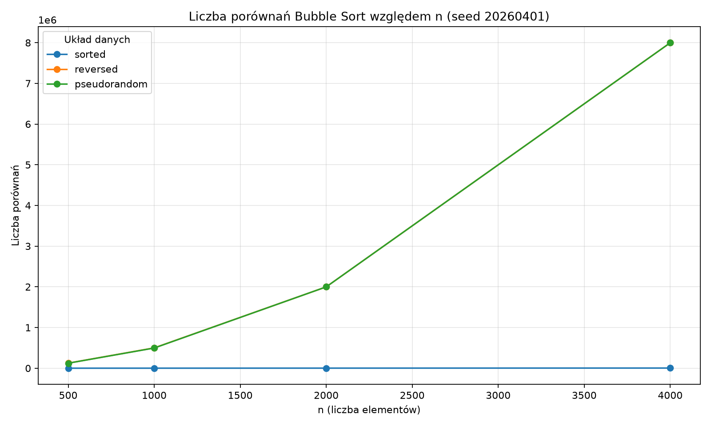
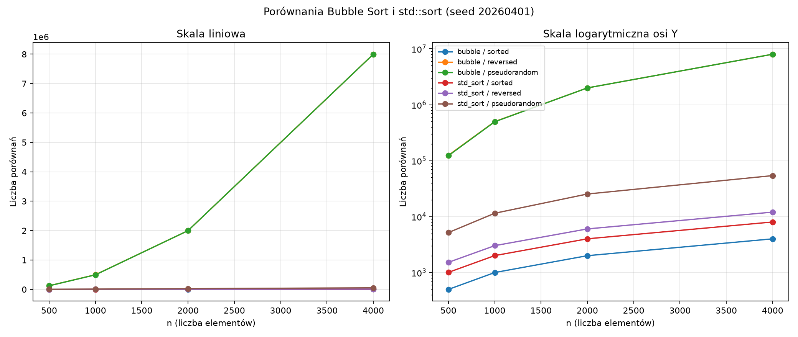

# Sprawozdanie TiDPI 04 - dane deterministyczne i powtarzalność

## Kryptonim TiDPI i wykonany poziom

- Kryptonim: **Regulus**.
- Lekcja: TiDPI 04, dane deterministyczne, powtarzalność i złożoność.
- Data prób: 2026-10-09.
- Zakres ukończony i sprawdzony: **poziomy A–D**.
- Checklist zakresu:
  - [x] A
  - [x] B
  - [x] C
  - [x] D
- Odstępstwa: polecenie zakłada Visual Studio 2022, MSVC i Windows. Prace wykonano na macOS/arm64 z Apple Clang. Kroków w Visual Studio nie wykonano.
- Wersja programu: [main.cpp](main.cpp) — program bazowy z lekcji. Badania poziomów C–D są w [rozszerzenia/](rozszerzenia/).

### Oddane pliki (poziomy A–D)

```text
TiDPI_04/
├── raport.md
├── main.cpp
├── wyniki/
│   ├── A_bazowy.txt
│   ├── A_zmieniony_seed.txt
│   ├── A_zmieniony_generator.txt
│   ├── A_powtorzony.txt
│   ├── Release_metadane.txt
│   └── debug/ (archiwum poprzedniej serii)
├── scripts/
│   ├── uruchom_release.py
│   └── opracuj_wyniki.py
├── images/
│   ├── B_porownania.png
│   └── D_std_sort_porownania.png
└── rozszerzenia/
    ├── C/
    │   ├── wiele_seedow/
    │   │   ├── main.cpp
    │   │   └── output.txt
    │   └── bez_early_exit/
    │       ├── main.cpp
    │       └── output.txt
    └── D/
        ├── main.cpp
        └── output.txt
```

- Program bazowy: [main.cpp](main.cpp).
- Pełny stdout bazowy: [wyniki/A_bazowy.txt](wyniki/A_bazowy.txt) — także źródło surowych danych poziomu B (seed `20260401`). Pliku `wyniki/B_surowe.txt` nie utworzono.
- Pełny stdout po zmianie seeda: [wyniki/A_zmieniony_seed.txt](wyniki/A_zmieniony_seed.txt).
- Pełny stdout po zmianie instrukcji generatora: [wyniki/A_zmieniony_generator.txt](wyniki/A_zmieniony_generator.txt).
- Wykres poziomu B: [images/B_porownania.png](images/B_porownania.png).
- C1 wiele seedów: [rozszerzenia/C/wiele_seedow/main.cpp](rozszerzenia/C/wiele_seedow/main.cpp), [rozszerzenia/C/wiele_seedow/output.txt](rozszerzenia/C/wiele_seedow/output.txt).
- C2 bez early-exit: [rozszerzenia/C/bez_early_exit/main.cpp](rozszerzenia/C/bez_early_exit/main.cpp), [rozszerzenia/C/bez_early_exit/output.txt](rozszerzenia/C/bez_early_exit/output.txt).
- D porównania std::sort: [rozszerzenia/D/main.cpp](rozszerzenia/D/main.cpp), [rozszerzenia/D/output.txt](rozszerzenia/D/output.txt).
- Wykres poziomu D: [images/D_std_sort_porownania.png](images/D_std_sort_porownania.png).
- Badanie „prawie posortowane” nie wykonano (wybrane dwa z trzech w C).


### Archiwum wcześniejszych wyników Debug

Poprzednia seria z 2026-10-02 (`-O0 -g -D_DEBUG`, macOS 27.0 build 26A428) została zachowana bez zmian w [wyniki/debug/](wyniki/debug/): `A_bazowy.txt`, `A_zmieniony_seed.txt`, `A_zmieniony_generator.txt`, `C_wiele_seedow.txt`, `C_bez_early_exit.txt` i `D_std_sort.txt`. Tabele i wykresy tego raportu korzystają wyłącznie z nowej serii Release z 2026-10-09. Odciski i liczniki Bubble porównano ze starymi plikami; są zgodne. Liczniki `std::sort` również pozostały identyczne w obecnym środowisku.

## Cel i hipoteza

Cel poziomu A: sprawdzić, czy ten sam przepis na dane (generator, seed, mapowanie, rozmiar, układ) daje ten sam odcisk wejścia; czy pięć prób tego samego przypadku daje identyczne liczniki operacji i `correct=true`; oraz czy zmiana seeda albo instrukcji generatora zmienia tylko dane pseudolosowe, a nie posortowane ani odwrócone.

Hipoteza A (zachowana z wcześniejszego raportu przed nową serią Release): dla stałego `n`, seeda i układu wszystkie pięć prób ma identyczny `fingerprint`, identyczne `comparisons`/`swaps`/`passes` i `correct=true`. Kolumna `time_us` może się różnić. Zmiana seeda zmieni odcisk i liczniki tylko dla `pseudorandom`. Zmiana mapowania `% 10'000U` zmieni odcisk pseudolosowy przy tym samym seedzie. Dane `sorted` i `reversed` nie zależą od seeda, bo `make_data` buduje je przez `std::iota` i `std::reverse`.

Cel poziomu B: zbadać tempo wzrostu pracy Bubble Sortu na seedzie `20260401` dla czterech rozmiarów i trzech układów, używając liczby porównań i zamian jako głównego dowodu złożoności; czasy pięciu prób zachować jako ślad, nie jako dowód klasy wzrostu.

Hipoteza B (zachowana przed nową serią Release): dla danych posortowanych współczynnik wzrostu porównań przy podwojeniu `n` będzie bliski 2 (zgodność z `n - 1`); dla odwróconych bliski 4 (zgodność z `n × (n - 1) / 2`); dla pseudolosowych przy seedzie `20260401` wzrost będzie empirycznie bliski kwadratowemu, bez nazywania tego formalnym przypadkiem średnim.

Cel poziomu C: sprawdzić granice uogólnienia na dwóch badaniach — (C1) wpływ wielu seedów na liczniki pseudolosowe; (C2) wpływ usunięcia early-exit na liczniki trzech układów przy identycznym wejściu.

Hipoteza C1 (zachowana przed nową serią Release): trzy nowe seedy (`20260403`, `20260404`, `20260405`) plus dwa bazowe dadzą różne odciski oraz zwykle różne `comparisons`/`swaps`/`passes` dla `pseudorandom`; żaden pojedynczy seed nie może być nazwany „przypadkiem średnim”.

Hipoteza C2 (zachowana przed nową serią Release): dla `sorted` wariant bez early-exit wykona pełne `n(n-1)/2` porównań zamiast `n-1`; dla `reversed` liczniki obu wariantów będą identyczne; dla `pseudorandom` wariant `full` będzie miał `comparisons`/`passes` nie mniejsze niż `early`, przy tym samym odcisku i `correct=true`.

Cel poziomu D: policzyć porównania wykonywane przez `std::sort` własnym komparatorem i ostrożnie zestawić tempo wzrostu z instrumentowanym Bubble Sortem na tych samych wejściach (seed `20260401`).

Hipoteza D (zachowana przed nową serią Release): przy identycznych wejściach liczba porównań `std::sort` będzie istotnie mniejsza niż Bubble Sortu dla `reversed`/`pseudorandom`, a współczynnik wzrostu przy podwojeniu `n` będzie bliższy ~2–2,5 (typowe dla O(n log n)) niż ~4 (O(n²) Bubble). Nie porównujemy czasów µs jako dowodu złożoności — tylko liczniki porównań. Dla `sorted` Bubble z early-exit może mieć *mniej* porównań niż `std::sort`. Wzrost liczników dla konkretnego układu ocenimy na podstawie pomiarów, bez zakładania z góry n log n.

## Środowisko oraz konfiguracja

Tabela 1 - narzędzia faktycznie użyte (D00).

| Element            | Wartość                    | Dowód |
| ------------------ | -------------------------- | ----- |
| System             | macOS 27.0.1, build 26A434   | D00   |
| Architektura       | arm64 (Apple Silicon)      | D00   |
| Kompilator         | Apple Clang 21.0.0, C++17  | D00   |
| Konfiguracja A–D | Release: `-O2 -DNDEBUG`, bez debuggera | D09 |
| Zegar w programie  | `steady_clock`, wynik w µs | kod   |
| Generator          | `std::mt19937`             | D01   |
| Mapowanie wartości | `generator() % 10'000U`    | D01   |

Pełna metryczka nowych uruchomień: [wyniki/Release_metadane.txt](wyniki/Release_metadane.txt).

### D00 — wersje narzędzi

```text
host=macOS 27.0.1 build 26A434
arch=arm64
Apple clang version 21.0.0 (clang-2100.3.34.2)
Target: arm64-apple-darwin27.0.0
actual_toolchain: Apple Clang on macOS arm64
configuration=Release
flags=-std=c++17 -O2 -DNDEBUG -Wall -Wextra -pedantic
execution=terminal_without_debugger
```

## Generator, seedy i sposób przygotowania danych

Przepis zapisany w nagłówku stdout ([wyniki/A_bazowy.txt](wyniki/A_bazowy.txt)):

- silnik: `std::mt19937`;
- seedy: `20260401`, `20260402`;
- rozmiary: 500, 1000, 2000, 4000;
- układy: `sorted`, `reversed`, `pseudorandom`;
- mapowanie: modulo 10 000 (`generator() % 10'000U`);
- liczba prób czasowych: 5;
- rotacja układów między próbami: `input_orders[(position + trial - 1) % 3]`.

W gałęzi pseudolosowej generator jest tworzony na nowo dla każdego wywołania `make_data`, więc ten sam seed zawsze startuje od tego samego stanu.

## Zmienne i warunki eksperymentu

- Stałe: `trial_count = 5`, algorytm: instrumentowane sortowanie bąbelkowe z wczesnym wyjściem.
- Przygotowanie danych, odcisk i wynik wzorcowy (`std::sort`) są poza stoperem w `run_trial`.
- Mierzony fragment: wyłącznie `bubble_sort` na kopii wejścia.
- Poziom A: Release `-O2 -DNDEBUG`, uruchomienie bez debuggera.
- Poziom B: te same wiersze seeda `20260401` z [wyniki/A_bazowy.txt](wyniki/A_bazowy.txt); główny dowód = `comparisons`/`swaps` (identyczne w pięciu próbach); `time_us` traktowane jako obserwacja w Release.
- Poziom C1: seedy `{20260401…20260405}`, tylko `pseudorandom`, `trial_count = 1`, Release.
- Poziom C2: seed `20260401`, trzy układy, warianty `early`/`full`, `trial_count = 1`, Release; bazowy [main.cpp](main.cpp) bez zmian.
- Poziom D: seed `20260401`, trzy układy, `bubble` vs `std_sort` z `CountingLess`, jedno uruchomienie każdego przypadku, Release; bazowy [main.cpp](main.cpp) bez zmian. W D nie mierzymy czasu.

## Kontrola wejścia, odcisków i poprawności

- Odcisk (`fingerprint`) liczony przed sortowaniem; służy do szybkiej kontroli zgodności wejścia.
- Poprawność: wynik `bubble_sort` porównany z `std::sort` na tej samej kopii (`correct`).
- [wyniki/A_bazowy.txt](wyniki/A_bazowy.txt): 120 wierszy wyników + `all_correct=true`, kod wyjścia 0.
- [wyniki/A_zmieniony_seed.txt](wyniki/A_zmieniony_seed.txt) i [wyniki/A_zmieniony_generator.txt](wyniki/A_zmieniony_generator.txt): również `all_correct=true`.
- Ponowne uruchomienie niezmienionego kodu bazowego dało te same odciski, liczniki i flagi `correct` co w pliku bazowym (różniły się tylko `time_us`).

## Procedura

### Poziom A

1. Zbudowano Release: `clang++ -std=c++17 -O2 -DNDEBUG -Wall -Wextra -pedantic -o .build/release/A_bazowy main.cpp`; uruchamiano z terminala bez debuggera.
2. Uruchomiono program bazowy; pełny stdout zapisano do [wyniki/A_bazowy.txt](wyniki/A_bazowy.txt).
3. Z przebiegu bazowego wyfiltrowano wiersze `n=500`, seed `20260401` — opracowanie D02 w raporcie.
4. W roboczej kopii kodu zmieniono `seeds[0]` z `20260401` na `20260499`, przebudowano w Release i uruchomiono; pełny stdout zapisano do [wyniki/A_zmieniony_seed.txt](wyniki/A_zmieniony_seed.txt).
5. W drugiej roboczej kopii kodu z seedami bazowymi zmieniono `% 10'000U` na `% 9'999U` w `make_data` i odpowiednio nagłówek mapowania, przebudowano w Release i uruchomiono; pełny stdout zapisano do [wyniki/A_zmieniony_generator.txt](wyniki/A_zmieniony_generator.txt).
6. Bazowy [main.cpp](main.cpp) pozostał bez zmian. Po obu wariantach uruchomiono go ponownie; [wyniki/A_powtorzony.txt](wyniki/A_powtorzony.txt) potwierdza zgodność odcisków, liczników i poprawności z wynikiem bazowym.

### Poziom B

1. Z [wyniki/A_bazowy.txt](wyniki/A_bazowy.txt) wyfiltrowano wiersze seeda `20260401` (4 rozmiary × 3 układy × 5 prób).
2. Dla każdego przypadku odczytano stałe `comparisons`/`swaps` oraz min/max `time_us` z pięciu prób.
3. Obliczono współczynniki wzrostu porównań przy podwojeniach `n` oraz porównano liczniki ze wzorami `n - 1` i `n × (n - 1) / 2`.
4. Wygenerowano wykres [images/B_porownania.png](images/B_porownania.png).

### Poziom C

1. Zbudowano i uruchomiono [rozszerzenia/C/wiele_seedow/main.cpp](rozszerzenia/C/wiele_seedow/main.cpp); stdout → [rozszerzenia/C/wiele_seedow/output.txt](rozszerzenia/C/wiele_seedow/output.txt).
2. Zbudowano i uruchomiono [rozszerzenia/C/bez_early_exit/main.cpp](rozszerzenia/C/bez_early_exit/main.cpp); stdout → [rozszerzenia/C/bez_early_exit/output.txt](rozszerzenia/C/bez_early_exit/output.txt).
3. Porównano liczniki między seedami (C1) oraz early vs full (C2); sprawdzono `all_correct=true` i wspólne odciski w C2.

### Poziom D

1. Zbudowano i uruchomiono [rozszerzenia/D/main.cpp](rozszerzenia/D/main.cpp); stdout → [rozszerzenia/D/output.txt](rozszerzenia/D/output.txt).
2. Obliczono współczynniki wzrostu porównań Bubble vs `std::sort` przy podwojeniach `n`.
3. Wygenerowano wykres [images/D_std_sort_porownania.png](images/D_std_sort_porownania.png).

## Surowe wyniki

### Rejestr dowodów

- **D00:** wersje narzędzi (sekcja Środowisko).
- **D01:** pełny stdout programu bazowego — [wyniki/A_bazowy.txt](wyniki/A_bazowy.txt).
- **D02:** pięć prób × trzy układy dla `n=500`, seed `20260401` (analiza w raporcie; źródło: D01).
- **D03:** pełny stdout po zmianie seeda `20260401` → `20260499` — [wyniki/A_zmieniony_seed.txt](wyniki/A_zmieniony_seed.txt).
- **D04:** pełny stdout po zmianie mapowania na `% 9'999U` — [wyniki/A_zmieniony_generator.txt](wyniki/A_zmieniony_generator.txt).
- **D05:** poziom B — tabele wzrostu i porównanie ze wzorami (źródło: seed `20260401` w D01) oraz wykres [images/B_porownania.png](images/B_porownania.png).
- **D06:** poziom C1 — wiele seedów — [rozszerzenia/C/wiele_seedow/output.txt](rozszerzenia/C/wiele_seedow/output.txt).
- **D07:** poziom C2 — early vs full — [rozszerzenia/C/bez_early_exit/output.txt](rozszerzenia/C/bez_early_exit/output.txt).
- **D08:** poziom D — Bubble vs `std::sort` (licznik komparatora) — [rozszerzenia/D/output.txt](rozszerzenia/D/output.txt), wykres [images/D_std_sort_porownania.png](images/D_std_sort_porownania.png).

- **D09:** metryczka Release, flagi kompilacji i kody wyjścia — [wyniki/Release_metadane.txt](wyniki/Release_metadane.txt); ponowne uruchomienie bazowe — [wyniki/A_powtorzony.txt](wyniki/A_powtorzony.txt).

### D01 — program bazowy

Pełny surowy output (nagłówek `engine`/`value_mapping`, 120 wierszy CSV, `all_correct=true`) jest w pliku [wyniki/A_bazowy.txt](wyniki/A_bazowy.txt). Poniżej tylko analiza wymagana poziomem A.

### D02 — n=500, seed=20260401: pięć odcisków i liczników dla każdego układu

Źródło: [wyniki/A_bazowy.txt](wyniki/A_bazowy.txt).

Tabela 2a - układ `sorted` (`n=500`, seed `20260401`).

| trial | fingerprint | comparisons | swaps | passes | correct | time_us [µs] |
| --- | --- | --- | --- | --- | --- | --- |
| 1 | 10234385171984889473 | 499 | 0 | 1 | true | 0 |
| 2 | 10234385171984889473 | 499 | 0 | 1 | true | 0 |
| 3 | 10234385171984889473 | 499 | 0 | 1 | true | 0 |
| 4 | 10234385171984889473 | 499 | 0 | 1 | true | 0 |
| 5 | 10234385171984889473 | 499 | 0 | 1 | true | 0 |

Tabela 2b - układ `reversed` (`n=500`, seed `20260401`).

| trial | fingerprint | comparisons | swaps | passes | correct | time_us [µs] |
| --- | --- | --- | --- | --- | --- | --- |
| 1 | 8837019113408834681 | 124750 | 124750 | 499 | true | 90 |
| 2 | 8837019113408834681 | 124750 | 124750 | 499 | true | 90 |
| 3 | 8837019113408834681 | 124750 | 124750 | 499 | true | 90 |
| 4 | 8837019113408834681 | 124750 | 124750 | 499 | true | 90 |
| 5 | 8837019113408834681 | 124750 | 124750 | 499 | true | 90 |

Tabela 2c - układ `pseudorandom` (`n=500`, seed `20260401`).

| trial | fingerprint | comparisons | swaps | passes | correct | time_us [µs] |
| --- | --- | --- | --- | --- | --- | --- |
| 1 | 4831905941288758783 | 122920 | 61066 | 439 | true | 140 |
| 2 | 4831905941288758783 | 122920 | 61066 | 439 | true | 128 |
| 3 | 4831905941288758783 | 122920 | 61066 | 439 | true | 119 |
| 4 | 4831905941288758783 | 122920 | 61066 | 439 | true | 117 |
| 5 | 4831905941288758783 | 122920 | 61066 | 439 | true | 114 |

Tabela 2d - co jest odtwarzalne, a co może się zmieniać (między pięcioma próbami).

| Wielkość                         | Między próbami (ten sam n, seed, układ) |
| -------------------------------- | --------------------------------------- |
| `fingerprint`                    | identyczny                              |
| `comparisons`, `swaps`, `passes` | identyczne                              |
| `correct`                        | zawsze `true`                           |
| `time_us`                        | może się zmieniać                       |

### D03 — zmiana seeda (20260401 → 20260499)

Pełny surowy output: [wyniki/A_zmieniony_seed.txt](wyniki/A_zmieniony_seed.txt).

Zmiana w roboczej kopii kodu (bazowy plik pozostał bez zmian):

```cpp
constexpr std::array<std::uint32_t, 2> seeds = {20260499, 20260402};
```

Tabela 3 - wpływ zmiany seeda na odciski (`n=500`).

| Układ | fingerprint seed 20260401 | fingerprint seed 20260499 | Zmiana? |
| --- | --- | --- | --- |
| sorted | 10234385171984889473 | 10234385171984889473 | nie |
| reversed | 8837019113408834681 | 8837019113408834681 | nie |
| pseudorandom | 4831905941288758783 | 12614073233898071586 | tak |

Wyjaśnienie z kodu: w `make_data` parametr `seed` trafia tylko do gałęzi `InputOrder::Pseudorandom` (`std::mt19937 generator(seed)`). Gałęzie `Sorted` i `Reversed` budują tablicę przez `std::iota` i ewentualnie `std::reverse`, więc seed nie wpływa na te układy. Liczniki `comparisons`/`swaps`/`passes` dla sorted i reversed pozostają bez zmian; dla pseudorandom zmieniają się wraz z nowym wejściem.

### D04 — zmiana instrukcji generatora (% 10'000U → % 9'999U)

Pełny surowy output: [wyniki/A_zmieniony_generator.txt](wyniki/A_zmieniony_generator.txt).

Zmiana w roboczej kopii kodu (bazowy plik pozostał bez zmian):

```cpp
value = static_cast<int>(generator() % 9'999U);
```

Tabela 4 - wpływ zmiany mapowania (`n=500`, seed `20260401`, układ `pseudorandom`).

| Wariant | fingerprint | comparisons | swaps | passes |
| --- | --- | --- | --- | --- |
| bazowy `% 10'000U` | 4831905941288758783 | 122920 | 61066 | 439 |
| `% 9'999U` | 16916683457636190562 | 124425 | 63118 | 474 |

Inne wartości w tablicy pseudolosowej zmieniają też pracę sortowania, więc liczniki operacji również się różnią — mimo że seed pozostał ten sam. Odciski `sorted` i `reversed` nie uległy zmianie (te układy nie korzystają z generatora).

Po badaniu wariantu ponowne uruchomienie niezmienionego [main.cpp](main.cpp) dało te same odciski i liczniki co [wyniki/A_bazowy.txt](wyniki/A_bazowy.txt) (czasy µs mogły się różnić).

## Liczba operacji i współczynniki wzrostu (poziom B)

Źródło surowych danych: wiersze seeda `20260401` w [wyniki/A_bazowy.txt](wyniki/A_bazowy.txt). W pięciu próbach każdego przypadku `comparisons` i `swaps` są identyczne; poniżej podano te stałe wartości oraz zakres `time_us`.

### D05 — seed 20260401, cztery rozmiary × trzy układy

Tabela 5 - liczniki operacji i zakres czasów [µs] (Release, D01).

| n | układ | comparisons | swaps | time_us min [µs] | time_us max [µs] |
| --- | --- | --- | --- | --- | --- |
| 500 | sorted | 499 | 0 | 0 | 0 |
| 500 | reversed | 124750 | 124750 | 90 | 90 |
| 500 | pseudorandom | 122920 | 61066 | 114 | 140 |
| 1000 | sorted | 999 | 0 | 0 | 0 |
| 1000 | reversed | 499500 | 499500 | 332 | 382 |
| 1000 | pseudorandom | 496260 | 248197 | 427 | 655 |
| 2000 | sorted | 1999 | 0 | 1 | 1 |
| 2000 | reversed | 1999000 | 1999000 | 878 | 1152 |
| 2000 | pseudorandom | 1998964 | 1000462 | 1709 | 2217 |
| 4000 | sorted | 3999 | 0 | 1 | 2 |
| 4000 | reversed | 7998000 | 7998000 | 2370 | 3457 |
| 4000 | pseudorandom | 7997565 | 3997984 | 4470 | 5911 |

Surowe czasy pięciu prób (kolejność jak w D01):

| n | układ | time_us [µs] (próby 1–5) |
| --- | --- | --- |
| 500 | sorted | 0, 0, 0, 0, 0 |
| 500 | reversed | 90, 90, 90, 90, 90 |
| 500 | pseudorandom | 140, 128, 119, 117, 114 |
| 1000 | sorted | 0, 0, 0, 0, 0 |
| 1000 | reversed | 341, 332, 333, 359, 382 |
| 1000 | pseudorandom | 427, 434, 439, 431, 655 |
| 2000 | sorted | 1, 1, 1, 1, 1 |
| 2000 | reversed | 1152, 1152, 1024, 994, 878 |
| 2000 | pseudorandom | 2217, 2104, 1932, 1763, 1709 |
| 4000 | sorted | 2, 1, 1, 1, 1 |
| 4000 | reversed | 3457, 2903, 2664, 2499, 2370 |
| 4000 | pseudorandom | 5911, 5435, 4989, 4619, 4470 |

Tabela 6 - współczynniki wzrostu porównań: `comparisons(2n) / comparisons(n)`.

| układ | 500→1000 | 1000→2000 | 2000→4000 | obserwacja |
| --- | --- | --- | --- | --- |
| sorted | 2.002004 | 2.001001 | 2.000500 | wzrost liniowy |
| reversed | 4.004008 | 4.002002 | 4.001001 | wzrost bliski kwadratowemu |
| pseudorandom | 4.037260 | 4.028058 | 4.000855 | wzrost bliski kwadratowemu |

Tabela 7 - porównanie ze wzorami.

| n | sorted observed | n - 1 | zgodne? | reversed observed | n(n - 1)/2 | zgodne? |
| --- | --- | --- | --- | --- | --- | --- |
| 500 | 499 | 499 | tak | 124750 | 124750 | tak |
| 1000 | 999 | 999 | tak | 499500 | 499500 | tak |
| 2000 | 1999 | 1999 | tak | 1999000 | 1999000 | tak |
| 4000 | 3999 | 3999 | tak | 7998000 | 7998000 | tak |

Dla danych odwróconych `swaps` jest równe `comparisons` i równe wzorowi. Dla posortowanych `swaps = 0` i `passes = 1` — wczesne wyjście po pierwszym przebiegu bez zamian.



Wykres: [images/B_porownania.png](images/B_porownania.png) — trzy serie porównań względem `n` (seed `20260401`). Serie `reversed` i `pseudorandom` leżą blisko siebie w skali liniowej i rosną znacznie szybciej niż `sorted`.

## Granice uogólnienia (poziom C)

### D06 — wiele seedów (pseudorandom)

Źródło: [rozszerzenia/C/wiele_seedow/output.txt](rozszerzenia/C/wiele_seedow/output.txt); kod: [rozszerzenia/C/wiele_seedow/main.cpp](rozszerzenia/C/wiele_seedow/main.cpp).

Parametry: seedy `{20260401, 20260402, 20260403, 20260404, 20260405}` (trzy nowe: `20260403`–`20260405`); rozmiary 500–4000; tylko `pseudorandom`; `trial_count = 1`; `mt19937` + `% 10'000U`; `all_correct=true`.

Tabela 8 - liczniki i odciski dla `n=500` (pięć seedów).

| seed | comparisons | swaps | passes | fingerprint | correct |
| --- | --- | --- | --- | --- | --- |
| 20260401 | 122920 | 61066 | 439 | 4831905941288758783 | true |
| 20260402 | 124189 | 64112 | 466 | 1748127650070261405 | true |
| 20260403 | 124315 | 64288 | 470 | 2019253337181905212 | true |
| 20260404 | 124372 | 63097 | 472 | 8589954449293142770 | true |
| 20260405 | 124540 | 60177 | 479 | 2737534714930217706 | true |

Tabela 9 - rozrzut między pięcioma seedami.

| n | comparisons min–max (zakres) | swaps min–max (zakres) | passes min–max (zakres) | unikalne odciski |
| --- | --- | --- | --- | --- |
| 500 | 122920–124540 (1620) | 60177–64288 (4111) | 439–479 (40) | 5/5 |
| 4000 | 7989354–7997565 (8211) | 3949068–4052038 (102970) | 3868–3970 (102) | 5/5 |

Dla `n=500` mediana comparisons = 124315; seed `20260401` leży poniżej mediany, `20260405` powyżej. Żadnego z tych pięciu nie nazywamy „przypadkiem średnim” — to pięć konkretnych, odtwarzalnych wejść.

### D07 — Bubble Sort z early-exit vs bez early-exit

Źródło: [rozszerzenia/C/bez_early_exit/output.txt](rozszerzenia/C/bez_early_exit/output.txt); kod: [rozszerzenia/C/bez_early_exit/main.cpp](rozszerzenia/C/bez_early_exit/main.cpp).

Parametry: seed `20260401`; rozmiary 500–4000; trzy układy; warianty `early` (z `if (!swapped) break`) i `full` (bez early-exit); ten sam `fingerprint` dla pary wariantów; `all_correct=true`.

Zmiana w wariancie `full` (względem bazy): usunięto blok

```cpp
if (!swapped) {
  break;
}
```

Tabela 10 - porównanie early vs full (`n=500`, seed `20260401`).

| układ | variant | comparisons | swaps | passes | fingerprint | correct |
| --- | --- | --- | --- | --- | --- | --- |
| sorted | early | 499 | 0 | 1 | 10234385171984889473 | true |
| sorted | full | 124750 | 0 | 499 | 10234385171984889473 | true |
| reversed | early | 124750 | 124750 | 499 | 8837019113408834681 | true |
| reversed | full | 124750 | 124750 | 499 | 8837019113408834681 | true |
| pseudorandom | early | 122920 | 61066 | 439 | 4831905941288758783 | true |
| pseudorandom | full | 124750 | 61066 | 499 | 4831905941288758783 | true |

Tabela 11 - porównanie early vs full (`n=4000`, seed `20260401`).

| układ | variant | comparisons | swaps | passes | fingerprint | correct |
| --- | --- | --- | --- | --- | --- | --- |
| sorted | early | 3999 | 0 | 1 | 11732463451640709189 | true |
| sorted | full | 7998000 | 0 | 3999 | 11732463451640709189 | true |
| reversed | early | 7998000 | 7998000 | 3999 | 14753679230542420197 | true |
| reversed | full | 7998000 | 7998000 | 3999 | 14753679230542420197 | true |
| pseudorandom | early | 7997565 | 3997984 | 3970 | 9686258832850047619 | true |
| pseudorandom | full | 7998000 | 3997984 | 3999 | 9686258832850047619 | true |

Obserwacje: dla `sorted` early = `n-1`, full = `n(n-1)/2`; dla `reversed` liczniki identyczne; dla `pseudorandom` early skraca końcówkę (`passes` i `comparisons` mniejsze), a `swaps` pozostaje ten sam (wszystkie potrzebne zamiany i tak wykonano wcześniej).

## Opracowanie wyników

| Dowód | Obserwacja                                                        | Kod wyjścia |
| ----- | ----------------------------------------------------------------- | ----------- |
| D01   | 120/120 wierszy `correct=true`, `all_correct=true`                | 0           |
| D02   | dla każdego układu: 1 odcisk, 1 zestaw liczników na 5 prób        | 0           |
| D03   | sorted/reversed bez zmian; pseudorandom inny odcisk i liczniki    | 0           |
| D04   | pseudorandom inny odcisk i liczniki przy tym samym seedzie        | 0           |
| D05   | sorted ~2×, reversed/pseudo ~4× przy podwojeniu n; wzory dokładne | 0           |
| D06   | 5 seedów → 5 odcisków; comps/swaps/passes różnią się              | 0           |
| D07   | early zmienia sorted i końcówkę pseudo; reversed bez zmian        | 0           |
| D08   | std_sort ≪ bubble na reversed/pseudo; wzrost ≈2–2.2 vs ≈4         | 0           |

Dodatkowa obserwacja z D01: dla `n=500` odciski `sorted` i `reversed` są identyczne dla obu seedów (`20260401` i `20260402`), natomiast `pseudorandom` różni się między seedami — zgodnie z kodem.

## Interpretacja

### Poziom A

**Odtworzenie danych** oznacza odtworzenie tego samego wejścia algorytmu: ten sam generator (`std::mt19937`), seed, mapowanie, rozmiar, układ i wersja kodu. Dowód: identyczny `fingerprint` między próbami i między dwoma uruchomieniami kodu bazowego.

**Powtórzenie wyniku funkcjonalnego** oznacza, że program wykonał tę samą pracę: te same liczniki `comparisons`/`swaps`/`passes` oraz `correct=true` względem wzorca `std::sort`. To jest silniejsze niż sam odcisk wejścia, bo obejmuje też zachowanie algorytmu.

**Identyczny czas** nie jest gwarantowany. Wynik `time_us` jest obcięty do pełnych mikrosekund, więc identyczne wartości, w tym zera, mogą ukrywać różnice poniżej tej jednostki. Przy identycznych danych i licznikach `time_us` w D02 może się różnić (np. pseudorandom: 114–140 µs); dla reversed zapisano we wszystkich pięciu próbach 90 µs. `steady_clock` mierzy czas wykonania w danym uruchomieniu i reaguje na obciążenie systemu, cache i inne czynniki środowiskowe.

### Poziom B

**Teoria / liczniki (główny dowód):** najlepszy przypadek to dane posortowane — dokładnie `n - 1` porównań, zero zamian, jeden przebieg; współczynniki wzrostu ≈ 2 wskazują klasę liniową. Niekorzystny przypadek to dane odwrócone — dokładnie `n × (n - 1) / 2` porównań i tyle samo zamian; współczynniki ≈ 4 wskazują klasę kwadratową. Dla seeda `20260401` układ pseudolosowy ma liczbę porównań bliską przypadkowi odwróconemu i współczynniki ≈ 4, ale nie nazywamy jednego seeda formalnym przypadkiem średnim.

**Obserwacje czasów (nie dowód klasy):** w Release `time_us` rośnie z `n` dla reversed/pseudorandom i pozostaje bardzo mały dla sorted, a wartości dla `sorted` mogą wynosić `0 µs` po obcięciu. Rozrzut czasów pozostałych przypadków oraz zaokrąglenie ograniczają ich interpretację. Dlatego złożoność wnioskujemy z liczników, nie z pojedynczych µs.

### Poziom C

**C1 — wiele seedów:** pięć różnych seedów dało pięć różnych odcisków i różne liczniki. Rozrzut comparisons przy `n=500` wynosi 1620 (ok. 1,3% względem minimum). Uogólnienie „seed X = przypadek średni” byłoby nieuprawnione — każdy seed to osobny, odtwarzalny przypadek testowy.

**C2 — early-exit:** warunek `!swapped` jest odpowiedzialny za liniowy najlepszy przypadek. Bez niego `sorted` wykonuje pełną pracę kwadratową przy zerze zamian. Dla `reversed` early-exit nic nie zmienia (zawsze jest zamiana). Dla `pseudorandom` early skraca końcowe puste przebiegi, ale nie zmienia liczby zamian. Identyczny `fingerprint` potwierdza, że porównujemy te same dane.

### Poziom D

**Metoda:** ten sam `source` (seed `20260401`) dla Bubble i `std::sort`; odcisk wspólny; `std::sort` z komparatorem `CountingLess` zliczającym wywołania. Dowód: [rozszerzenia/D/output.txt](rozszerzenia/D/output.txt).

Tabela 12 - liczba porównań Bubble vs `std::sort`.

| n | układ | bubble comparisons | std_sort comparisons |
| --- | --- | --- | --- |
| 500 | sorted | 499 | 1006 |
| 500 | reversed | 124750 | 1521 |
| 500 | pseudorandom | 122920 | 5177 |
| 1000 | sorted | 999 | 2006 |
| 1000 | reversed | 499500 | 3021 |
| 1000 | pseudorandom | 496260 | 11472 |
| 2000 | sorted | 1999 | 4006 |
| 2000 | reversed | 1999000 | 6021 |
| 2000 | pseudorandom | 1998964 | 25328 |
| 4000 | sorted | 3999 | 8006 |
| 4000 | reversed | 7998000 | 12021 |
| 4000 | pseudorandom | 7997565 | 54016 |

Tabela 13 - współczynniki wzrostu porównań `ops(2n)/ops(n)`.

| układ / algo | 500→1000 | 1000→2000 | 2000→4000 |
| --- | --- | --- | --- |
| bubble / sorted | 2.002 | 2.001 | 2.001 |
| bubble / reversed | 4.004 | 4.002 | 4.001 |
| bubble / pseudorandom | 4.037 | 4.028 | 4.001 |
| std_sort / sorted | 1.994 | 1.997 | 1.999 |
| std_sort / reversed | 1.986 | 1.993 | 1.997 |
| std_sort / pseudorandom | 2.216 | 2.208 | 2.133 |



**Interpretacja (ostrożna):** dla `pseudorandom` liczba porównań `std::sort` rośnie przy podwojeniu n około 2,13–2,22 razy, co jest zgodne z intuicją wzrostu n log n, ale cztery rozmiary nie stanowią dowodu asymptotycznego. Bubble rośnie w tym badaniu około czterokrotnie. Dla `sorted` wyniki `std::sort` wynoszą dokładnie `2n + 6`, a dla `reversed` — `3n + 21` dla wszystkich czterech rozmiarów. Oba układy wykazują więc liniowy wzrost w badanym zakresie tej implementacji libc++, a nie obserwowany wzrost n log n. Nie uogólniamy tych empirycznych zależności na każde wejście ani inną bibliotekę.

Dla `sorted` Bubble z early-exit ma mniej porównań (499 wobec 1006 przy n=500), lecz oba algorytmy pokazują tu liniowy wzrost liczników. Dla `reversed` i `pseudorandom` `std::sort` ma znacznie mniej porównań niż Bubble. Licznik komparatora mierzy wywołania w użytej implementacji, a nie teoretyczne minimum. W D nie mierzono czasu; mniejsza liczba porównań sama nie przesądza o przewadze czasowej. Wykres pokazuje skalę liniową i logarytmiczną osi Y, aby wszystkie serie były czytelne.

## Ograniczenia eksperymentu

1. Czasy poziomów A–C pochodzą z Release `-O2 -DNDEBUG`, bez debuggera. W D nie mierzono czasu. Czasy dotyczą instrumentowanego Bubble Sortu i zależą od obciążenia systemu; nie dowodzą same w sobie klasy złożoności. Wartość `0 µs` oznacza, że po obcięciu do pełnych mikrosekund wynik wynosi zero, a nie że sortowanie nie trwało.
2. Odcisk nie jest dowodem matematycznym równości danych — tylko wygodnym skrótem kontrolnym.
3. Modulo `% 10'000U` może wprowadzać niewielkie odchylenie rozkładu; w tej lekcji akceptujemy to świadomie.
4. Wyniki pochodzą z jednej maszyny macOS/arm64 (Apple Clang / libc++); liczba porównań `std::sort` może różnić się między bibliotekami standardowymi.
5. Skala liniowa wykresu B sprawia, że seria sorted jest wizualnie „przy osi” względem reversed/pseudorandom — to skutek różnicy rzędów wielkości, nie błąd danych.
6. Badanie „prawie posortowane” nie zostało wykonane (wybrane C1 i C2).
7. Licznik komparatora `std::sort` ≠ formalne dolne ograniczenie informacyjne; to empiryczny pomiar konkretnej implementacji.

## Wnioski

1. Program bazowy działa poprawnie: [wyniki/A_bazowy.txt](wyniki/A_bazowy.txt) ma `all_correct=true` i kod 0.
2. Dla stałego `n`, seeda i układu pięć prób daje identyczne odciski, liczniki operacji i `correct=true`; zmienia się głównie `time_us`.
3. Seed wpływa tylko na dane pseudolosowe — sorted i reversed są od niego niezależne, bo kod nie używa generatora w tych gałęziach.
4. Zmiana mapowania generatora (`% 10'000U` → `% 9'999U`) zmienia dane pseudolosowe i przez to odcisk oraz liczniki sortowania.
5. Odtworzenie danych i powtórzenie wyniku funkcjonalnego są osiągalne deterministycznie; identyczny czas — nie.
6. Poziom B: sorted ma liniowy najlepszy przypadek (`n - 1`); reversed ma kwadratowy niekorzystny (`n(n-1)/2`); pseudorandom (seed `20260401`) empirycznie bliski kwadratowemu — potwierdzone współczynnikami wzrostu ≈ 2 / ≈ 4 / ≈ 4.
7. Poziom C1: różne seedy dają różne odciski i liczniki pseudolosowe — nie wolno jednego seeda nazywać przypadkiem średnim.
8. Poziom C2: early-exit tworzy liniowy najlepszy przypadek; bez niego `sorted` wraca do `n(n-1)/2` porównań; `reversed` pozostaje bez zmian.
9. Poziom D: `std::sort` (libc++) ma znacznie mniej porównań niż Bubble dla `reversed`/`pseudorandom`. Dla `sorted` i `reversed` wykazuje liniowy wzrost w badanym zakresie; dla `pseudorandom` współczynniki 2,13–2,22 są zgodne z intuicją n log n. Mniejsza liczba porównań Bubble dla `sorted` nie dowodzi uniwersalnej przewagi czasowej.

## Wykorzystanie AI i sposób weryfikacji

Codex pomógł zbudować programy A–D, zapisać stdout, obliczyć współczynniki wzrostu, wygenerować skrypty od stworzenia porównań w B i D oraz uporządkować raport na podstawie mocka. 

Sprawdzono ręcznie: `all_correct=true` w D01/D06/D07/D08; zgodność sorted = `n-1` i reversed = `n(n-1)/2` dla Bubble; różne odciski pięciu seedów w D06; w D07 identyczne fingerprint early/full; w D08 wspólne fingerprint bubble/std_sort oraz ilorazy wzrostu (np. `12021/6021 ≈ 1.997`).
