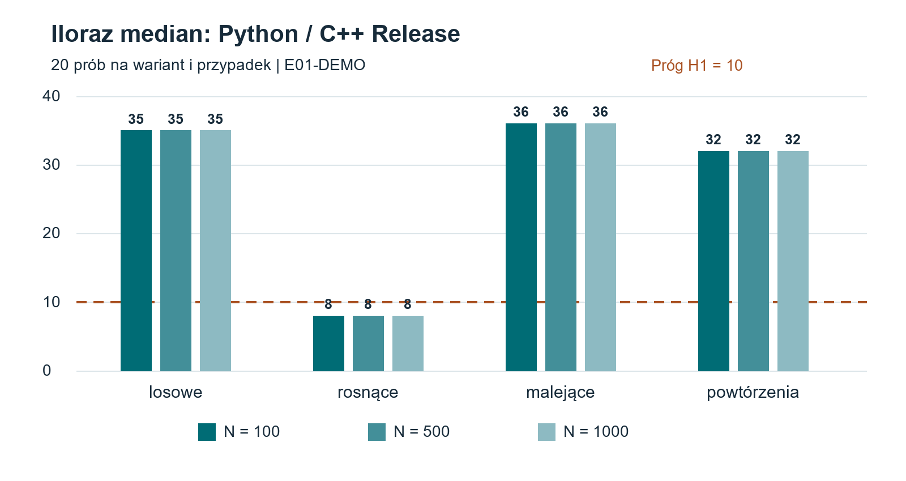

# Raport końcowy Projektu 01

**Temat 01:** sortowanie bąbelkowe liczb całkowitych w C++ i Pythonie. **Identyfikator przebiegu:** E01-DEMO. **Stan:** wersja końcowa po audycie.

**Uwaga dydaktyczna:** raport jest fikcyjnym, wypełnionym wzorcem pracy do oddania. Dalej opisuje badanie tak, jak raport z wykonanych pomiarów; we własnych pracach należy podać własne rzeczywiste dane, działania i dowody.

## 1. Streszczenie

Porównano dwie implementacje tego samego sortowania bąbelkowego: C++ Release oraz CPython. Obie porównywały sąsiadów, zamieniały elementy ustawione w złej kolejności, skracały sprawdzany fragment i kończyły wcześniej, gdy przejście nie wykonało żadnej zamiany. Żadnej implementacji nie zastąpiono gotową funkcją biblioteczną.

Zbadano trzy rozmiary: **100, 500 i 1000 liczb**, oraz cztery rodzaje danych: losowe, rosnące, malejące i z powtórzeniami. Dla każdego z 12 przypadków wykonano po dwie rozgrzewki i 20 właściwych prób każdego wariantu. Do analizy przyjęto **480 poprawnych rekordów**. Nie odrzucono żadnej próby pomiarowej ani wartości odstającej.

Hipoteza H1 zakładała, że w każdym przypadku iloraz median czasu Python / C++ wyniesie co najmniej 10. Otrzymano **35,0 dla danych losowych, 8,0 dla rosnących, 36,0 dla malejących i 32,0 dla danych z powtórzeniami** we wszystkich trzech rozmiarach. Warunek spełniło 9 z 12 przypadków. **Wyniki nie wspierają H1 w pełnym zaplanowanym zakresie**, mimo że we wszystkich przypadkach mediana C++ była niższa.

Wynik dotyczy opisanych implementacji, wspólnych danych i jednej sesji na wskazanym komputerze. Nie pozwala przewidzieć przyspieszenia dowolnego programu po przepisaniu do C++ ani przenieść otrzymanych ilorazów na inne algorytmy.

### Mapa raportu

Rozdziały 2-5 opisują plan, dane, implementacje i pomiar. Rozdziały 6-7 pokazują walidację i automatyzację. Rozdziały 8-10 przedstawiają liczby i wnioski. Rozdziały 11-13 dokumentują audyt, odtwarzalność i współpracę.

<div class="page-break"></div>

## 2. Pytanie, hipoteza i zmienne

**Pytanie badawcze:** jak dla wskazanych rozmiarów i układów danych różnią się mediany czasu dwóch implementacji tego samego algorytmu bąbelkowego?

**H1:** dla każdego z 12 zaplanowanych przypadków mediana czasu CPythona jest co najmniej dziesięciokrotnie większa niż mediana czasu C++ Release.

**Reguła decyzji:** oblicza się R = mediana Python / mediana C++. H1 wspiera dopiero R ≥ 10 w każdym przypadku, przy poprawnych i porównywalnych próbach. Wystarczy jeden przypadek z R < 10, by cały warunek nie był spełniony. Brak wiarygodnych danych lub walidacji oznacza brak podstaw do rozstrzygnięcia, a nie sukces hipotezy. To kryterium opisowe, nie test istotności statystycznej.

Kartę E01 w wersji 1.0 zamrożono 7 listopada, przed właściwą serią pomiarową. Kryterium R ≥ 10 zachowano bez zmian. Wynik dla danych rosnących uwzględniono w ocenie H1, chociaż nie spełnił przyjętego progu. Plan, recenzję i historię decyzji zapisano w katalogu `plan/`.

| Rodzaj zmiennej              | Definicja przyjęta w badaniu                                                              |
| :--------------------------- | :---------------------------------------------------------------------------------------- |
| Niezależna: implementacja    | `bubble_cpp_release` i `bubble_cpython`.                                                  |
| Niezależne: przypadek danych | Rozmiar N oraz jeden z czterech układów.                                                  |
| Zależna                      | Czas jednej operacji sortowania, w ms, wyliczony z czasu całej próby.                     |
| Główna statystyka            | Mediana 20 czasów jednej operacji w danej grupie.                                         |
| Kontrolowane                 | Ten sam plik wejściowy, algorytm, granica pomiaru i liczba rund w parze.                  |
| Potencjalnie zakłócające     | Obciążenie systemu, temperatura, kolejność, praca alokatora i różne środowiska wykonania. |

**„Szybciej”** znaczy tutaj „z niższą medianą czasu jednej operacji w tej samej grupie”. **„Poprawnie”** znaczy „pełny wynik równy uporządkowanemu wzorcowi, z zachowaniem wszystkich wartości i duplikatów”.

## 3. Dlaczego właśnie ten algorytm?

Zaimplementowano algorytm wskazany w przydzielonym temacie. Dla `[5, 3, 2]` pierwsze przejście daje kolejno `[3, 5, 2]` i `[3, 2, 5]`; drugie kończy się `[2, 3, 5]`. Taką samą kolejność porównań i regułę zakończenia zastosowano w obu językach.

Dane rosnące włączono do badania, ponieważ uruchamiają wcześniejsze zakończenie po pierwszym przejściu bez zamian. Dane malejące wymagają wielu zamian, a powtórzenia pozwalają sprawdzić zachowanie równych wartości. Dzięki temu porównanie obejmuje więcej niż jeden korzystnie wybrany układ.

<div class="page-break"></div>

## 4. Wspólne dane i ich tożsamość

Dane wygenerowano jednorazowo, a następnie oba programy odczytywały te same pliki CSV z jednym wierszem liczb całkowitych. Każdy plik miał kodowanie ASCII, nie zawierał nagłówka i kończył się pojedynczym znakiem LF. Zakres generatora danych losowych wynosił od -10 000 do 10 000. Układy rosnące i malejące uzyskano przez uporządkowanie tego samego losowego zestawu dla danego N. W przypadkach z powtórzeniami występowały wyłącznie wartości -1, 0 i 1.

**Tabela 1. Dane wejściowe i liczba rund wewnętrznych w jednej próbie.**

| Przypadek   |    N |  Seed | Rundy w próbie | SHA-256: początek |
| :---------- | ---: | ----: | -------------: | :---------------- |
| losowe      |  100 | 42100 |            500 | `2c7d4f7631ff`    |
| losowe      |  500 | 42500 |             20 | `8152b2e04f78`    |
| losowe      | 1000 | 43000 |             10 | `b9519bb8725a`    |
| rosnące     |  100 | 42100 |          10000 | `f0d09daf58ad`    |
| rosnące     |  500 | 42500 |           2000 | `b33a6906d4ce`    |
| rosnące     | 1000 | 43000 |           1000 | `4b8235b768da`    |
| malejące    |  100 | 42100 |            500 | `5f891894e994`    |
| malejące    |  500 | 42500 |             20 | `6a1a3e038b2d`    |
| malejące    | 1000 | 43000 |             10 | `bf5916159d1d`    |
| powtórzenia |  100 | 42100 |            500 | `d22ef6720405`    |
| powtórzenia |  500 | 42500 |             20 | `820117d32fc3`    |
| powtórzenia | 1000 | 43000 |             10 | `61ba99fe46ee`    |

Pełne skróty SHA-256 i ścieżki znajdują się w `../data/manifest.csv`. Fragment skrótu w tabeli służy tylko wygodnemu odszukaniu wpisu. To pełny skrót pliku, a nie seed, pozwala sprawdzić zgodność bajtów. Użycie takiego samego seeda w dwóch niezależnych generatorach nie gwarantowałoby zgodności.

Przed serią sprawdzono rozmiar i SHA-256 każdego wejścia. Oba warianty zapisywały identyfikator przypadku i skrót odczytanego pliku; zestawiono je z manifestem. Skróty obu wariantów były zgodne. Wynik referencyjny zachowywał wszystkie elementy i ich powtórzenia.

### Dobór rozmiarów i rund

Rozmiary dobrano podczas kalibracji, aby porównać małe i większe zadania, a jednocześnie zakończyć pełną serię w czasie zajęć. Do krótkich operacji zastosowano więcej wewnętrznych rund. Dla N = 1000 było to 10 rund przy danych losowych i 1000 przy rosnących. W każdej parze C++-Python liczba rund była identyczna.

Wyników kalibracji nie włączono do analizy końcowej. Po ustaleniu parametrów zapisano konfigurację i wykonano osobną serię E01-DEMO. Każda właściwa próba obejmowała co najmniej kilka milisekund pracy mierzonej; przeliczenie na jedno sortowanie opisano w rozdziale 8.

<div class="page-break"></div>

## 5. Implementacje, środowisko i pomiar

### Ten sam kontrakt w obu językach

C++ korzystał z `std::vector<int>`, a Python z listy liczb całkowitych. W obu programach zaimplementowano opisane porównania i zamiany samodzielnie, bez `std::sort` i `list.sort()` w mierzonym fragmencie. Gotowego sortowania użyto wyłącznie poza pomiarem do przygotowania wzorca walidacji.

Przed każdą rundą przygotowywano świeżą kopię nieposortowanego wejścia. Wszystkie kopie potrzebne do jednej próby powstawały **przed startem zegara**. W pomiarze znajdowała się pętla wywołań sortowania, obejmująca zamiany elementów i wynik utworzony w tych kopiach. Każdą kopię sortowano tylko raz. Nie odejmowano narzutu pętli wywołań: stanowił część zmierzonej próby w obu implementacjach.

Zegar zatrzymywano przed sprawdzeniem wyników. Poza pomiarem pozostawały: start procesu, odczyt i parsowanie, przygotowanie kopii, wzorca i skrótów, porównanie wyniku oraz zapis rekordu. Dla pustej i jednoelementowej tablicy algorytm kończy bez porównywania sąsiadów.

**Tabela 2. Środowisko wykonania serii E01-DEMO.**

| Pole           | Zarejestrowana wartość                                         |
| :------------- | :------------------------------------------------------------- |
| Sprzęt         | Intel Core i5-10400; 12 procesorów logicznych; 16 GB RAM.      |
| System         | Windows 11 23H2, x64; komputer podłączony do zasilania.        |
| Tryb zasilania | Nie ustalono wiarygodnie; ograniczenie opisane w raporcie.     |
| C++            | MSVC 19.40; C++17; Release, x64; bez debuggera.                |
| Python         | CPython 3.12.7, x64; osobny proces; bez dodatkowych bibliotek. |
| Zegary         | `std::chrono::steady_clock` i `time.perf_counter_ns()`.        |
| Sesja          | E01-DEMO, 14.11.2026, 10:00-11:00 CET.                         |

Program C++ skompilowano w konsoli narzędzi MSVC x64 poleceniem:

```text
cl /nologo /std:c++17 /O2 /EHsc /DNDEBUG src/cpp/main.cpp
   /Fe:build/bubble.exe
```

Powyższe dwa wiersze oznaczają jedno polecenie. Kompilacja zakończyła się kodem 0. Pełne polecenie, wersję kompilatora i strumienie wyjściowe zapisano w `logs/compile_summary.txt`, `compile_stdout.txt` oraz `compile_stderr.txt`. Nie dołączano kompilatu do paczki: odtwarza go skrypt automatyzacji.

<div class="page-break"></div>

## 6. Walidacja funkcjonalna i kontrolowany błąd

Walidator porównywał **cały wynik każdej rundy** ze wspólnym wzorcem, poza pomiarem czasu. Sprawdzał także długość tablicy. Nie ograniczano kontroli do sumy elementów lub uporządkowania: taka kontrola mogłaby nie wykryć zmiany wartości albo utraty elementu.

Testy z tabeli 3 wykonano w obu implementacjach przed serią pomiarową. Każdy test zakończył się oczekiwanym wynikiem. Próby ze świadomie wprowadzonym błędem miały sprawdzić reakcję walidatora i nie należały do właściwej serii czasów.

**Tabela 3. Testy funkcjonalne i uzyskane reakcje obu implementacji.**

| Wejście / sytuacja                                             | Uzyskany wynik lub reakcja                                    |
| :------------------------------------------------------------- | :------------------------------------------------------------ |
| `[]`                                                           | `[]`; sukces.                                                 |
| `[7]`                                                          | `[7]`; sukces.                                                |
| `[5, 3, 2]`                                                    | `[2, 3, 5]`; sukces.                                          |
| `[-1, 0, -1, 1]`                                               | `[-1, -1, 0, 1]`; zachowanie duplikatu.                       |
| `[1, 2, 3]`                                                    | Ten sam wynik, wcześniejsze zakończenie.                      |
| `[3, 2, 1]`                                                    | `[1, 2, 3]`; pełne sortowanie.                                |
| Kontrolowana zamiana wyniku na `[1, 2, 4]` zamiast `[1, 2, 3]` | Walidator wykrywa błąd; kod 1; brak publikacji wyników serii. |
| Brak wejścia lub uszkodzony rekord                             | Kod 2; czytelny błąd kontraktu lub środowiska.                |

Kod 0 oznaczał poprawne wykonanie, kod 1 niezgodność wyniku, a kod 2 błąd środowiska lub kontraktu. Kontrolowana zmiana `[1, 2, 3]` na `[1, 2, 4]` została odrzucona przez walidator. Skrypt przerwał taki przebieg i nie opublikował częściowego CSV.

W serii E01-DEMO wszystkie 480 prób pomiarowych przeszło walidację. Dla każdego rekordu `correct=true` wynikało z porównania wszystkich wyników rund ze wzorcem. Zachowano logi kontroli oraz wszystkie surowe rekordy, także przed zbudowaniem wspólnego podsumowania.

## 7. Automatyzacja i plan serii

Całą serię wykonano jednym poleceniem uruchamiającym `run_benchmark.py`. Skrypt sprawdził narzędzia, wejścia i manifest, skompilował C++ oraz zapisał polecenie, stdout, stderr i kod zakończenia. Następnie uruchamiał warianty w osobnych procesach, zbierał rekordy i sprawdzał kompletność. Dopiero po pomyślnej kontroli opublikował zwalidowany CSV i podsumowania.

Przed każdą serią wykonano **2 rozgrzewki na wariant i przypadek**, czyli 48 rozgrzewek łącznie. Następnie wykonano 20 prób na wariant i przypadek: 12 × 2 × 20 = **480**. W nieparzystych rundach prób pierwszy był C++, w parzystych Python. Pola `trial` i `order` pozwalają odtworzyć tę kolejność. Rozgrzewki zachowano w logach, lecz nie włączono ich do statystyk.

Kontrakt rekordu zawiera wersję protokołu, run_id, task, language, implementation, case_id, size, rounds, warmup, trial, order, time_ns, result_checksum i correct. Parser sprawdzał tożsamość rekordu, typy pól, dodatni czas, zgodność przypadku i liczbę rund. Testy braku próby, duplikatu oraz błędnego wyniku potwierdziły, że skrypt zatrzymuje publikację niekompletnej serii.

<div class="page-break"></div>

## 8. Wyniki: C++ Release

Wszystkie czasy w tabelach odnoszą się do **jednego sortowania**, nie całej próby. Dla każdego rekordu oblicza się:

**t [ms] = time_ns / rounds / 1 000 000.**

Na przykład próba trwająca 20 000 000 ns i obejmująca 10 rund daje 2,0 ms na sortowanie. Dopiero z 20 takich wartości w grupie wyznacza się statystyki. Nie dzieli się raz policzonego wspólnego czasu przez łączną liczbę prób.

**Tabela 4. C++ Release; każda pozycja: 20 poprawnych prób.**

| Przypadek         | Min [ms] | Mediana [ms] | Średnia [ms] |  s [ms] | Max [ms] |
| :---------------- | -------: | -----------: | -----------: | ------: | -------: |
| losowe, 100       |  0,01800 |      0,02000 |      0,02000 | 0,00127 |  0,02200 |
| losowe, 500       |  0,45000 |      0,50000 |      0,50000 | 0,03183 |  0,55000 |
| losowe, 1000      |  1,80000 |      2,00000 |      2,00000 | 0,12732 |  2,20000 |
| rosnące, 100      |  0,00072 |      0,00080 |      0,00080 | 0,00005 |  0,00088 |
| rosnące, 500      |  0,00360 |      0,00400 |      0,00400 | 0,00025 |  0,00440 |
| rosnące, 1000     |  0,00720 |      0,00800 |      0,00800 | 0,00051 |  0,00880 |
| malejące, 100     |  0,02250 |      0,02500 |      0,02500 | 0,00159 |  0,02750 |
| malejące, 500     |  0,56250 |      0,62500 |      0,62500 | 0,03979 |  0,68750 |
| malejące, 1000    |  2,25000 |      2,50000 |      2,50000 | 0,15915 |  2,75000 |
| powtórzenia, 100  |  0,01350 |      0,01500 |      0,01500 | 0,00095 |  0,01650 |
| powtórzenia, 500  |  0,33750 |      0,37500 |      0,37500 | 0,02387 |  0,41250 |
| powtórzenia, 1000 |  1,35000 |      1,50000 |      1,50000 | 0,09549 |  1,65000 |

Mediana dla 20 wartości jest średnią arytmetyczną dwóch środkowych wartości po uporządkowaniu. Średnia uwzględnia wszystkie 20 liczb. Symbol **s** oznacza odchylenie standardowe próbki, z dzieleniem przez n - 1; opisuje rozrzut czasów, a nie niepewność oszacowania mediany.

Przykład dla danych losowych i N = 1000: dwa środkowe czasy C++ wynoszą 1,98 i 2,02 ms, więc mediana wynosi (1,98 + 2,02) / 2 = **2,00 ms**. Minimum to 1,80 ms, maksimum 2,20 ms. Obliczenia wykonuje dołączony skrypt.

Zgodnie z planem nie usuwano wartości odstających wyłącznie z powodu wysokiego czasu. Tabele 4-5 obejmują łącznie wszystkie 480 poprawnych rekordów; każda z 24 grup ma 20 obserwacji. Nie wykonywano filtrowania poprawiającego wynik hipotezy.

<div class="page-break"></div>

## 9. Wyniki: CPython i rozrzut

**Tabela 5. CPython; każda pozycja: 20 poprawnych prób.**

| Przypadek         | Min [ms] | Mediana [ms] | Średnia [ms] |   s [ms] |  Max [ms] |
| :---------------- | -------: | -----------: | -----------: | -------: | --------: |
| losowe, 100       |  0,63000 |      0,70000 |      0,70000 |  0,04456 |   0,77000 |
| losowe, 500       | 15,75000 |     17,50000 |     17,50000 |  1,11405 |  19,25000 |
| losowe, 1000      | 63,00000 |     70,00000 |     72,10000 | 11,79005 | 119,00000 |
| rosnące, 100      |  0,00576 |      0,00640 |      0,00640 |  0,00041 |   0,00704 |
| rosnące, 500      |  0,02880 |      0,03200 |      0,03200 |  0,00204 |   0,03520 |
| rosnące, 1000     |  0,05760 |      0,06400 |      0,06400 |  0,00407 |   0,07040 |
| malejące, 100     |  0,81000 |      0,90000 |      0,90000 |  0,05729 |   0,99000 |
| malejące, 500     | 20,25000 |     22,50000 |     22,50000 |  1,43236 |  24,75000 |
| malejące, 1000    | 81,00000 |     90,00000 |     90,00000 |  5,72943 |  99,00000 |
| powtórzenia, 100  |  0,43200 |      0,48000 |      0,48000 |  0,03056 |   0,52800 |
| powtórzenia, 500  | 10,80000 |     12,00000 |     12,00000 |  0,76392 |  13,20000 |
| powtórzenia, 1000 | 43,20000 |     48,00000 |     48,00000 |  3,05569 |  52,80000 |

W grupie losowe, N = 1000 zarejestrowano wysoki czas **119,0 ms**, równy 170% mediany tej grupy. Pozostawiono go w danych. Średnia wynosi **72,1 ms**, a mediana **70,0 ms**. Wartość pokazuje, dlaczego samej średniej nie należy utożsamiać z całym obrazem próby.

Nie ustalono przyczyny wysokiego czasu. Logi nie pozwoliły powiązać go z konkretnym procesem w tle lub zmianą taktowania. Pozostawiono obserwację w analizie, ponieważ wynik sortowania był poprawny, a plan nie przewidywał jej automatycznego odrzucenia. Nie dopisywano wyjaśnienia o antywirusie bez dowodu.

W tabelach przedstawiono pięć miejsc po przecinku, aby małe czasy nie zniknęły po zaokrągleniu do zera. To format prezentacji danych, nie deklaracja takiej dokładności rzeczywistego zegara. W CSV `time_ns` jest całkowitym czasem całej próby. Analiza nie wykorzystuje zaokrąglonych komórek raportu.

Każdą liczbę można odtworzyć z `../results/raw/e01.csv`, wybierając `case_id` oraz `language`, uwzględniając wyłącznie rekordy `warmup=false` i przeliczając `time_ns` przez liczbę rund. Surowy zbiór zawiera wyłącznie takie rekordy; niczego nie usunięto w celu poprawienia wyniku.

<div class="page-break"></div>

## 10. Porównanie, odpowiedź na H1 i ograniczenia

**Tabela 6. R = mediana Python / mediana C++; iloraz bez jednostki.**

| Rodzaj danych | N = 100 | N = 500 | N = 1000 | H1: wszystkie R ≥ 10? |
| :------------ | ------: | ------: | -------: | :-------------------- |
| losowe        |    35,0 |    35,0 |     35,0 | tak                   |
| rosnące       |     8,0 |     8,0 |      8,0 | nie                   |
| malejące      |    36,0 |    36,0 |     36,0 | tak                   |
| powtórzenia   |    32,0 |    32,0 |     32,0 | tak                   |

{width=100%}

**H1 w pełnym zakresie nie jest wsparta:** trzy przypadki rosnące mają R = 8,0 < 10. Dziewięć pozostałych spełnia próg. Nie wolno zastąpić zdania „dla każdego przypadku” zdaniem „dla większości”, bo byłaby to zmiana pytania po zobaczeniu wyniku.

Przykładowo dla losowych 1000 elementów R = 70,0 / 2,0 = **35,0**, a dla rosnących 1000 elementów R = 0,064 / 0,008 = **8,0**. Wszystkie mediany C++ są niższe; to węższe stwierdzenie jest zgodne z danymi, ale nie ratuje mocniejszej H1.

Wcześniejsze zakończenie zmienia ilość pracy dla danych rosnących: algorytm wykonuje jedno przejście bez zamian. Dokładnej wartości różnicy między implementacjami nie przypisuje się jednak samemu językowi: obejmuje także reprezentację liczb, kompilator, interpreter i narzut pętli. Wykres pokazuje ilorazy median, nie rozrzut; rozrzut znajduje się w tabelach 4-5.

<div class="page-break"></div>

### 10.1. Jak daleko sięga wniosek?

| Ograniczenie                                      | Konsekwencja                                                                   |
| :------------------------------------------------ | :----------------------------------------------------------------------------- |
| Jeden zestaw wejściowy dla kombinacji układu i N. | Nie bada się wszystkich możliwych zestawów liczb.                              |
| Jeden komputer i jedna sesja.                     | Nie ocenia się innych procesorów ani stabilności między dniami.                |
| Trzy rozmiary i jeden algorytm.                   | Nie przenosi się wyników na inne zadania ani gotowe sortowania.                |
| Rundy wewnętrzne i ich pętla w pomiarze.          | Koszt organizacji próby może mieć większy udział przy krótkich operacjach.     |
| Naprzemienność bez losowania.                     | Ogranicza stałą przewagę pierwszego wariantu, ale nie wyklucza dryfu warunków. |
| Nieznany tryb zasilania.                          | Brakuje jednego składnika opisu środowiska.                                    |

Główny wniosek brzmi: **w przebiegu E01-DEMO dla badanych implementacji sortowania bąbelkowego iloraz median Python / C++ wynosił od 8,0 do 36,0, zależnie od rodzaju danych**. Wynik dotyczy opisanych wejść, sprzętu, konfiguracji i procedury. Nie uprawnia do stwierdzenia, że każdy program w C++ jest od 8 do 36 razy szybszy od odpowiednika w Pythonie.

### 10.2. Rozszerzenia

Nie dodano trzeciego języka ani eksperymentu z sortowaniami bibliotecznymi. Wykonano pełny rdzeń przydzielonego tematu obejmujący cztery układy wejść. Dalsze badanie warto rozszerzyć o niezależne sesje, kilka zestawów liczb na przypadek i losowanie kolejności wariantów. Tych rozszerzeń nie uwzględnia się w obecnych wnioskach.

## 11. Audyt i ślad poprawki

**A-01, poważne:** w pierwszej wersji streszczenia zapisano „we wszystkich przypadkach co najmniej dziesięciokrotnie”. Audyt tabeli 6 wykazał trzy przypadki z R = 8. Poprawiono streszczenie i odpowiedź na H1, podając 9 z 12 oraz niewsparcie hipotezy w pełnym zakresie. Ponownie sprawdzono wszystkie ilorazy i zgodność wniosków. **Stan: zamknięte.**

**A-02, poważne:** pierwsza wersja tabeli używała czasu całej próby zamiast czasu jednego sortowania. W analizie zastosowano `time_ns / rounds / 1 000 000` przed obliczeniem statystyk i odtworzono zależne tabele oraz wykres. Retest objął przypadki z 10, 20, 500, 1000, 2000 i 10 000 rund. **Stan: zamknięte.**

Po poprawkach prześledzono liczby od CSV do raportu w ramach kontroli partner_A, a zakres wniosków i podpisy sprawdzono w ramach kontroli partner_B. Kontrola 2,00 ms, 72,10 ms oraz R = 8,0 zakończyła się zgodnością z danymi. Zapis ustaleń i dowody retestów zachowano w protokole audytu. Surowe czasy pozostawiono bez zmian.

<div class="page-break"></div>

## 12. Rejestr dowodów i odtwarzalność

| ID  | Deklaracja                                       | Dowód i sposób sprawdzenia                                                            | Stan |
| :-- | :----------------------------------------------- | :------------------------------------------------------------------------------------ | :--- |
| D01 | Oba warianty odczytały te same dane.             | `data/manifest.csv`, wejścia i logi serii; porównanie pełnych SHA-256.                | PASS |
| D02 | Wszystkie 480 prób są poprawne.                  | Surowe rekordy i logi walidacji; zgodność pełnych wyników ze wzorcem.                 | PASS |
| D03 | Tabele 4-5 zawierają poprawne statystyki.        | `results/raw/e01.csv` i `src/automation/analyze_results.py`; ponowne przeliczenie.    | PASS |
| D04 | Wykres i tabela 6 przedstawiają te same ilorazy. | `results/summary/summary.json` i `report/images/ilorazy.png`; kontrola 12 wartości.   | PASS |
| D05 | Kryterium H1 nie zmieniło się po pomiarach.      | `plan/karta_E01.md` w wersji 1.0 i dziennik decyzji.                                  | PASS |
| D06 | Kontrolowany błąd blokuje publikację serii.      | Log testu walidatora: kod 1 i brak pliku wyników dla błędnego przebiegu.              | PASS |
| D07 | Projekt uruchamia się z czystej kopii.           | Protokół odtworzenia według README; kompilacja i test poprawności zakończone kodem 0. | PASS |

Ścieżki w rejestrze podano względem katalogu głównego projektu. W raporcie źródłem danych liczbowych jest `../results/raw/e01.csv`, a źródłem obliczeń `../src/automation/analyze_results.py`.

### 12.1. Odtworzenie analizy

Z katalogu głównego projektu uruchomiono:

```powershell
python src/automation/analyze_results.py
```

Skrypt odtworzył `results/summary/statistics.csv` i `summary.json`. Kontrola potwierdziła 480 rekordów, 24 grupy po 20 oraz 9 z 12 przypadków spełniających próg H1. Sprawdzono filtry, jednostkę i kierunek ilorazu. Do analizy wykorzystano niezaokrąglone wartości.

### 12.2. Kontrola czystej kopii i dokumentów

W ramach kontroli partner_B skopiowano projekt do osobnego katalogu, uruchomiono go według README i potwierdzono odtworzenie kompilatu oraz poprawny wynik testu kontrolnego. Dla ponownego uruchomienia zastosowano osobny identyfikator; nie nadpisano serii E01-DEMO stanowiącej podstawę raportu. Po kontroli usunięto z kopii do oddania kompilaty i cache.

PDF wygenerowano z Markdown przez Pandoc. Sprawdzono zgodność tabel, wykresu i wniosków, polskie znaki, podziały stron oraz względne odnośniki do obrazów. Paczkę przejrzano pod kątem danych osobowych, prywatnych ścieżek i sekretów. Pozostawiono źródła, dane, logi oraz dokumentację.

<div class="page-break"></div>

## 13. Współpraca, AI i zamknięcie

### 13.1. Wkład partnerów

| Etap                   | partner_A                                                  | partner_B                                              |
| :--------------------- | :--------------------------------------------------------- | :----------------------------------------------------- |
| Plan, 7.11             | Opracowanie kontraktu i hipotezy.                          | Recenzja zmiennych i kryterium decyzji.                |
| Implementacje, 8-10.11 | Implementacja C++ i przegląd Pythona.                      | Implementacja Pythona i przegląd C++.                  |
| Poprawność, 10-12.11   | Przygotowanie testów brzegowych i kontroli pełnego wyniku. | Przeprowadzenie kontrolowanego błędu i testów parsera. |
| Analiza, 14.11         | Kontrola jednostek, rund i kompletności.                   | Obliczenie statystyk i przygotowanie wykresu.          |
| Zamknięcie, 14.11      | Uzupełnienie README i kontrola liczb w raporcie.           | Audyt i kontrola czystej kopii.                        |

Dziennik pracy zapisano w `teamwork/dziennik_pracy.md`, z datami, rezultatami i dowodami. Wykonano wzajemny przegląd implementacji i próbną obronę. Sprawdzono rozumienie całej metody przez każdego partnera.

### 13.2. Wykorzystanie AI i weryfikacja sugestii

Korzystano z agenta Codex do recenzji planu, propozycji testów walidatora oraz przeglądu wniosków. Decyzje i sposób sprawdzenia zapisano w `teamwork/wykorzystanie_AI.md`.

| Sugestia                                  | Decyzja i sposób weryfikacji                                                        |
| :---------------------------------------- | :---------------------------------------------------------------------------------- |
| Sprawdzać pełny wynik, nie samą sumę.     | Przyjęto; zmieniony element został wykryty w kontrolowanym teście.                  |
| Oddzielić czas próby od czasu sortowania. | Przyjęto; sprawdzono przeliczenie dla wszystkich użytych liczb rund.                |
| Pominąć najwolniejszą poprawną próbę.     | Odrzucono; plan nie przewidywał takiego filtrowania.                                |
| Doprecyzować odpowiedź na H1.             | Przyjęto; porównano każde R z progiem 10 i zachowano trzy niespełniające przypadki. |

Nie traktowano odpowiedzi AI jako dowodu wykonania testu. Każdą przyjętą sugestię sprawdzono w kodzie, danych albo logach. Nie przekazywano danych osobowych ani sekretów.

### 13.3. Końcowa wypowiedź do obrony

> Porównano dwie implementacje sortowania bąbelkowego na wspólnych wejściach, przy tej samej granicy pomiaru: 12 przypadków, po 20 poprawnych prób na wariant. Iloraz median Python / C++ wyniósł od 8 do 36. Wyniki nie wspierają H1 wymagającej co najmniej 10 w każdym przypadku. Zachowano wszystkie poprawne czasy i dowody. Wniosek dotyczy jednej sesji, opisanego komputera i badanych implementacji.

**Decyzja końcowa:** zakończono badanie i poprawki po audycie. Zachowano pierwotne kryterium H1 i dowody. Raport zatwierdzono wspólnie.
