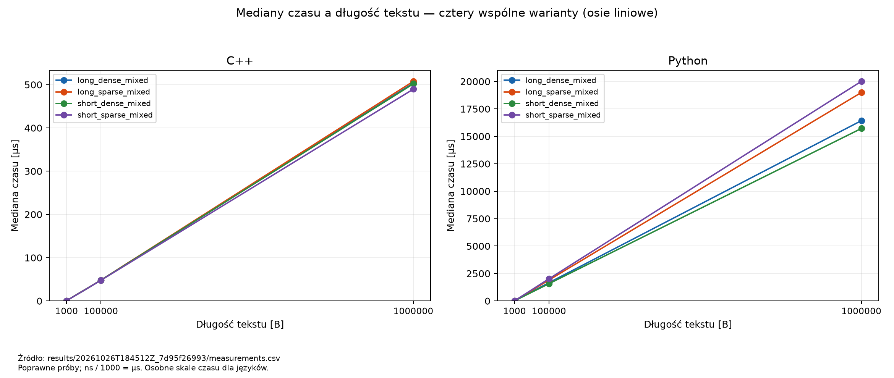
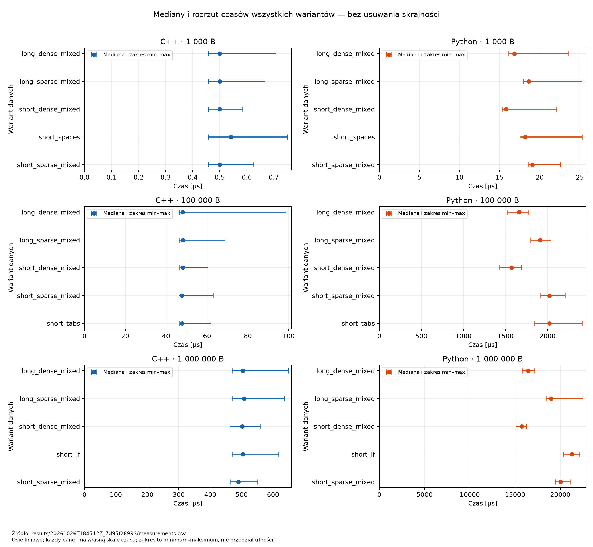

# Licznik słów ASCII — analiza czasu wykonania C++ i Pythona

## Cel i hipoteza

Celem jest porównanie czasu wykonania tego samego algorytmu liczenia słów w C++ i Pythonie dla różnych długości i budowy tekstu ASCII. Pytanie badawcze: jak długość tekstu, długość słów i gęstość separatorów wiążą się z medianą oraz rozrzutem czasu w obu implementacjach?

Hipoteza: przy stałym wariancie danych czas rośnie w przybliżeniu proporcjonalnie do liczby bajtów, ponieważ algorytm odwiedza każdy znak raz. Budowa tekstu może wpływać na stały koszt przetwarzania. Hipotezę zapisano podczas opracowania raportu, **po zebraniu pomiarów**, więc nie stanowi ona deklaracji zarejestrowanej przed eksperymentem. Nie zakładamy z góry przewagi języka.

Analiza dotyczy wyłącznie przebiegu `20261026T184512Z_7d95f26993` z 26 października 2026, 18:45:12–18:45:28 UTC (19:45:12–19:45:28 czasu polskiego). Źródła: [surowy CSV](results/20261026T184512Z_7d95f26993/measurements.csv), [metadane](results/20261026T184512Z_7d95f26993/metadata.json), [podsumowanie](results/20261026T184512Z_7d95f26993/summary.json). Nie wykonywano nowych pomiarów benchmarkowych na potrzeby tego raportu.

## Definicja słowa i algorytm

Słowo jest niepustym ciągiem znaków rozdzielanym wyłącznie spacją ASCII (`0x20`), tabulatorem (`0x09`) lub LF (`0x0A`). Interpunkcja oraz CR (`0x0D`) należą do słowa. Pusty tekst zawiera zero słów.

Obie implementacje zaczynają od licznika `0` i stanu `inWord = false`. Separator zeruje stan. Znak niebędący separatorem zwiększa licznik tylko wtedy, gdy stan był fałszywy, po czym ustawia stan na prawdziwy. Koniec pliku nie wymaga doliczania słowa. Algorytm nie używa `split` ani ogólnej klasy białych znaków. Złożoność czasowa wynosi O(n), a dodatkowa pamięć algorytmu O(1); wczytany wcześniej tekst zajmuje O(n).

Oczekiwane wyniki przypadków kontrolnych są zapisane ręcznie w `WordGenerator.FIXTURES`, niezależnie od zgodności obu programów:

| Wejście (zapis znaków specjalnych) | Oczekiwane słowa |
| ---------------------------------- | ---------------: |
| pusty tekst                        |                0 |
| ` \t\n  \n\t`                      |                0 |
| `word` bez separatora na końcu     |                1 |
| `Ala  ma`                          |                2 |
| `Ala\tma\nkota`                    |                3 |
| `\t\ncat  dog\n\t`                 |                2 |
| `kot,pies`                         |                1 |
| `Ala\rma`                          |                1 |

W tej sesji uruchomiono testy automatu i analizy. Nie przeprowadzano ponownie pełnego zestawu testów funkcjonalnych obu implementacji. Zgodność 900 wyników w historycznym CSV z oczekiwaniami manifestów jest osobnym sprawdzeniem dla danych benchmarkowych, a nie dowodem wykonania wszystkich powyższych przypadków kontrolnych.

## Dane wejściowe

Zestaw zawiera 15 plików ASCII: po pięć dla 1 000, 100 000 i 1 000 000 B. Dla ASCII bajt odpowiada jednemu znakowi. Manifesty zapisują ziarna odpowiednio 14, 42 i 2026, konfigurację generatora, oczekiwane liczby słów i SHA-256. Wszystkie 15 aktualnych plików wejściowych ma SHA-256 zgodne z metadanymi analizowanego przebiegu.

Generator wybiera pełne słowa z lokalnego słownika 250 słów: krótkie mają 1–5 liter, długie 7–8. Oczekiwana liczba słów jest zwiększana podczas dodawania pełnego słowa, niezależnie od badanych liczników. Pozostałe miejsce w pliku jest wypełniane separatorami. Pochodzenie słownika i sposób selekcji zapisano w polu `vocabulary_source` historycznych manifestów, np. [manifestu 1 000 B](data/1000B_seed14/manifest.json). Obecna [kopia słownika](assets/english_words.json) zawiera jedynie listy słów; analiza nie weryfikuje ponownie zewnętrznego źródła.

Cztery warianty występują przy każdej długości:

- `short_sparse_mixed`: krótkie słowa, pojedyncze separatory w cyklu spacja/tabulator/LF;
- `short_dense_mixed`: krótkie słowa, grupy ośmiu separatorów w tym cyklu;
- `long_sparse_mixed`: długie słowa, pojedyncze separatory;
- `long_dense_mixed`: długie słowa, grupy ośmiu separatorów.

Dodatkowo dla 1 000 B występuje `short_spaces`, dla 100 000 B `short_tabs`, a dla 1 000 000 B `short_lf`: krótkie słowa z pojedynczym separatorem jednego rodzaju. To **niepełna macierz długość–wariant**. Brak pozostałych kombinacji nie jest utraconą próbą: nie były zaplanowane w metadanych. Tych trzech wariantów nie wolno traktować jako jednej serii do oceny wpływu samej długości lub rodzaju separatora.

Oczekiwania dla wszystkich plików benchmarkowych:

| Długość [B] | Wariant              | Oczekiwane słowa |
| ----------: | -------------------- | ---------------: |
|        1000 | `long_dense_mixed`   |               65 |
|        1000 | `long_sparse_mixed`  |              119 |
|        1000 | `short_dense_mixed`  |               88 |
|        1000 | `short_spaces`       |              219 |
|        1000 | `short_sparse_mixed` |              225 |
|      100000 | `long_dense_mixed`   |             6498 |
|      100000 | `long_sparse_mixed`  |            11904 |
|      100000 | `short_dense_mixed`  |             8747 |
|      100000 | `short_sparse_mixed` |            22452 |
|      100000 | `short_tabs`         |            22511 |
|     1000000 | `long_dense_mixed`   |            64966 |
|     1000000 | `long_sparse_mixed`  |           119166 |
|     1000000 | `short_dense_mixed`  |            87327 |
|     1000000 | `short_lf`           |           224800 |
|     1000000 | `short_sparse_mixed` |           224791 |

## Środowisko i metoda pomiaru

Poniższe parametry pochodzą z historycznych metadanych, a nie z domysłów o obecnym komputerze:

- CPU: Apple M4 Pro, architektura arm64, 14 logicznych CPU. Ilość RAM, model urządzenia, zasilanie, temperatura i obciążenie w chwili pomiaru nie zostały zapisane.
- System: `macOS-27.0.1-arm64-arm-64bit-Mach-O`.
- Python: 3.14.4, kompilacja `main, Apr 7 2026, 13:13:20`, Clang 21.0.0 (`clang-2100.0.123.102`).
- Kompilator C++: Apple clang 21.0.0 (`clang-2100.3.34.2`), target `arm64-apple-darwin27.0.0`, model wątków `posix`.
- Flagi: `-std=c++17 -O2 -Wall -Wextra -Wpedantic`. Program uruchamiany bez debuggera; według metody automatu każdorazowo kompilowany do nowego katalogu przebiegu.

Każda kombinacja język–plik ma 30 powtórzeń, bez rozgrzewek: 15 × 2 × 30 = 900 prób. Dla prób nieparzystych kolejność to C++ → Python, dla parzystych Python → C++. Procesy są uruchamiane sekwencyjnie; każda próba to nowy proces i jedno wywołanie funkcji liczącej.

Pomiar obejmuje algorytm i uzyskanie wyniku liczbowego. Nie obejmuje uruchomienia procesu, odczytu pliku, dekodowania ASCII, drukowania, kontroli poprawności ani tworzenia struktury przechowującej wynik pomiaru. Dane są wczytywane binarnie, z zachowaniem różnicy CR/LF. Oczekiwanie jest sprawdzane po pomiarze. Limit pojedynczego procesu wynosi 30 s.

C++ używa monotonicznego `std::chrono::steady_clock`, z nominalnym okresem typu zegara 1/1 000 000 000 s. Python używa `time.perf_counter_ns()`; implementacja to `mach_absolute_time()`, zegar monotoniczny, nieregulowany, deklarowana rozdzielczość 4,166666666666666 × 10⁻⁸ s, czyli około 41,67 ns. Okres nominalny C++ nie jest zmierzoną rozdzielczością sprzętu. Jednostka zapisu `ns` nie oznacza dokładności 1 ns.

Krótkie pomiary mogą być skwantowane przez zegar i obciążone kosztem jego odczytu. Czas `0` oznaczałby brak rozróżnialnego dodatniego odstępu w takim pomiarze, a nie dowód bezkosztowego wykonania. W tym przebiegu zer nie ma; analizator zachowuje je, jeśli wystąpią. Nie odjęto kosztu zegara i nie usuwano obserwacji skrajnych.

### Polecenia i odtworzenie analizy

Polecenia wykonuje się z katalogu projektu. Analiza z przypiętą wersją Matplotlib wymaga Pythona 3.11+; użyto wersji 3.11.2. Testy korzystają z biblioteki standardowej, a testy integracyjne automatu wymagają kompilatora C++17.

```sh
python3 -m venv .venv-analysis
.venv-analysis/bin/python -m pip install -r requirements-analysis.txt
.venv-analysis/bin/python -B Analyze.py --run-dir results/20261026T184512Z_7d95f26993 --output-dir analysis
python3 -B -m unittest discover -s tests -v
```

W Windows należy użyć interpretera `.venv-analysis\Scripts\python.exe`; przenośność tych poleceń i wykresów na Windows nie była testowana. Analizator zapisuje `statistics.csv`, `completeness.csv`, `issues.csv`, `provenance.json` oraz PNG w podkatalogu `images/`. Kod wyjścia `0` oznacza brak odstępstw kontroli CSV i podsumowania, `1` — wykryte odstępstwa, `2` — błąd wejścia, zależności lub zapisu. Niezgodność historycznych źródeł jest raportowana osobno w `provenance.json`; kod `0` nie potwierdza ich tożsamości.

Polecenie kompilacji zapisane dla historycznego przebiegu:

```sh
c++ -std=c++17 -O2 -Wall -Wextra -Wpedantic source/cpp/main.cpp -o results/20261026T184512Z_7d95f26993/word-counter
```

To zapis historyczny — nie należy wykonywać go nad istniejącym artefaktem. Przy nowym eksperymencie automat tworzy świeży katalog:

```sh
python3 -B Benchmark.py
```

Jest to polecenie odpowiadające zapisanej konfiguracji domyślnej (30 prób, bez rozgrzewek). Metadane nie zawierają pełnej oryginalnej linii wywołania automatu. Nowy przebieg będzie dotyczył obecnego kodu, więc nie zastąpi identycznie historycznego eksperymentu. Szczegóły: [instrukcja benchmarku](BENCHMARK.md).

Interfejs obecnego generatora przewiduje poniższe polecenia do **osobnego** katalogu, bez nadpisywania danych źródłowych. **Próba odtworzenia ujawniła jednak błąd `KeyError: 'source'` podczas zapisu manifestu:** `WordGenerator.py` oczekuje pola `source`, którego brakuje w `assets/english_words.json`. Polecenia dokumentują parametry zestawu, ale obecnie nie kończą się sukcesem. Nie naprawiano generatora w ramach analizy historycznych pomiarów.

```sh
python3 -B WordGenerator.py --output-dir regenerated/1000B_seed14 --sizes 1000 --seed 14
python3 -B WordGenerator.py --output-dir regenerated/100000B_seed42 --sizes 100000 --seed 42
python3 -B WordGenerator.py --output-dir regenerated/1000000B_seed2026 --sizes 1000000 --seed 2026
```

Przed błędem zapisu manifestu obecny generator zapisuje siedem wariantów dla każdego rozmiaru oraz przypadki kontrolne. Pełne odtwarzanie wymaga osobnej naprawy brakujących metadanych źródła słownika. Historyczny zestaw wybrał po pięć wariantów. Przy odtwarzaniu eksperymentu trzeba wybrać pliki wskazane w historycznych metadanych i sprawdzić ich SHA-256; nie należy bezpośrednio porównywać benchmarku wszystkich nowo wygenerowanych plików z tym przebiegiem.

## Kontrola kompletności i obliczenia

Kontrola [kompletności](analysis/completeness.csv) potwierdziła 900 wierszy, 30 grup język–plik i w każdej dokładnie 30 unikalnych numerów prób 1–30. Wszystkie statusy są `valid`, wyniki liczenia odpowiadają oczekiwaniom, jednostką jest `ns`, a identyfikatory, rozmiary, warianty i SHA-256 odpowiadają metadanym. Zweryfikowano pozycję języka w każdej parze i liczniki `summary.json`. Nie ma braków, duplikatów ani odrzuceń. [Rejestr odstępstw](analysis/issues.csv) zawiera wyłącznie nagłówek.

Do statystyk dopuszcza się wyłącznie poprawne, jednoznaczne próby z poprawnymi polami. W razie duplikatu numeru próby analizator zgłasza problem i wyłącza wszystkie kopie tego numeru; nie wybiera dogodnego pomiaru. Odrzucone próby są wykazywane z przyczynami, ale ich czasy nie wchodzą do statystyk. Brakująca wartość nie jest zerem.

Dla posortowanych 30 czasów mediana wynosi `(t[15] + t[16]) / 2`, przy numerowaniu od 1. Minimum i maksimum są skrajnymi pomiarami, a rozstęp to `maksimum − minimum`. Tabele pozostają w ns, aby zachować wyniki połówkowe bez zaokrągleń; wykresy pokazują te same wartości podzielone przez 1000, w µs. Rozstęp opisuje zaobserwowany zakres i zależy od liczby prób; nie jest przedziałem ufności.

### Statystyki wszystkich kombinacji

Źródło każdej poniższej tabeli: [surowe pomiary](results/20261026T184512Z_7d95f26993/measurements.csv). Pełna wersja maszynowa: [statistics.csv](analysis/statistics.csv). Każdy wiersz ma 30 poprawnych prób; wartości skrajne zachowano.

#### Tekst 1000 B

| Język  | Wariant            |   n | Mediana [ns] | Minimum [ns] | Maksimum [ns] | Rozstęp [ns] |
| ------ | ------------------ | --: | -----------: | -----------: | ------------: | -----------: |
| C++    | long_dense_mixed   |  30 |        500.0 |          458 |           708 |          250 |
| Python | long_dense_mixed   |  30 |      16854.0 |        16125 |         23542 |         7417 |
| C++    | long_sparse_mixed  |  30 |        500.0 |          458 |           667 |          209 |
| Python | long_sparse_mixed  |  30 |      18604.5 |        17959 |         25250 |         7291 |
| C++    | short_dense_mixed  |  30 |        500.0 |          458 |           584 |          126 |
| Python | short_dense_mixed  |  30 |      15792.0 |        15292 |         22083 |         6791 |
| C++    | short_spaces       |  30 |        541.5 |          458 |           750 |          292 |
| Python | short_spaces       |  30 |      18167.0 |        17500 |         25292 |         7792 |
| C++    | short_sparse_mixed |  30 |        500.0 |          458 |           625 |          167 |
| Python | short_sparse_mixed |  30 |      19083.5 |        18542 |         22584 |         4042 |

#### Tekst 100000 B

| Język  | Wariant            |   n | Mediana [ns] | Minimum [ns] | Maksimum [ns] | Rozstęp [ns] |
| ------ | ------------------ | --: | -----------: | -----------: | ------------: | -----------: |
| C++    | long_dense_mixed   |  30 |      48104.0 |        46541 |         98666 |        52125 |
| Python | long_dense_mixed   |  30 |    1664354.0 |      1517625 |       1774958 |       257333 |
| C++    | long_sparse_mixed  |  30 |      48250.0 |        46375 |         68667 |        22292 |
| Python | long_sparse_mixed  |  30 |    1909438.0 |      1797375 |       2038334 |       240959 |
| C++    | short_dense_mixed  |  30 |      48167.0 |        46666 |         60417 |        13751 |
| Python | short_dense_mixed  |  30 |    1573875.0 |      1431292 |       1688291 |       256999 |
| C++    | short_sparse_mixed |  30 |      47750.0 |        46250 |         63000 |        16750 |
| Python | short_sparse_mixed |  30 |    2020042.0 |      1917500 |       2207916 |       290416 |
| C++    | short_tabs         |  30 |      47896.0 |        46584 |         61917 |        15333 |
| Python | short_tabs         |  30 |    2020479.0 |      1841875 |       2409167 |       567292 |

#### Tekst 1000000 B

| Język  | Wariant            |   n | Mediana [ns] | Minimum [ns] | Maksimum [ns] | Rozstęp [ns] |
| ------ | ------------------ | --: | -----------: | -----------: | ------------: | -----------: |
| C++    | long_dense_mixed   |  30 |     503541.5 |       469834 |        648750 |       178916 |
| Python | long_dense_mixed   |  30 |   16429583.5 |     15767708 |      17169208 |      1401500 |
| C++    | long_sparse_mixed  |  30 |     507792.0 |       469708 |        635500 |       165792 |
| Python | long_sparse_mixed  |  30 |   18996687.0 |     18418667 |      22482667 |      4064000 |
| C++    | short_dense_mixed  |  30 |     502041.5 |       462125 |        558417 |        96292 |
| Python | short_dense_mixed  |  30 |   15717312.5 |     15106792 |      16245209 |      1138417 |
| C++    | short_lf           |  30 |     504020.5 |       469833 |        617333 |       147500 |
| Python | short_lf           |  30 |   21284062.5 |     20324625 |      22123375 |      1798750 |
| C++    | short_sparse_mixed |  30 |     489667.0 |       464584 |        551333 |        86749 |
| Python | short_sparse_mixed |  30 |   20014896.0 |     19455250 |      21085000 |      1629750 |

Przykłady niezależnej kontroli arytmetycznej: dla C++ `short_spaces`, 1 000 B, dwie środkowe wartości wynoszą 541 i 542 ns, więc mediana to `(541 + 542) / 2 = 541,5 ns`, a rozstęp `750 − 458 = 292 ns`. Dla Pythona `long_sparse_mixed`, 1 000 000 B, wartości środkowe 18 995 708 i 18 997 666 ns dają medianę 18 996 687 ns, a rozstęp `22 482 667 − 18 418 667 = 4 064 000 ns`.

### Wykresy



Rysunek 1. Mediany czterech wariantów dostępnych dla wszystkich długości. Osie długości i czasu są liniowe; oba języki mają osobne skale czasu. Punkty są pomiarami, a odcinki tylko je łączą — nie stanowią dopasowanego modelu. Źródło: [CSV przebiegu](results/20261026T184512Z_7d95f26993/measurements.csv). Liniowa oś długości ścieśnia punkty 1 000 i 100 000 B; dokładne liczby znajdują się w tabelach.



Rysunek 2. Punkt oznacza medianę, końce odcinka minimum i maksimum z 30 prób. Wszystkie obserwacje skrajne wchodzą do zakresu. Każdy panel ma własną liniową skalę czasu w µs; długość odcinków należy porównywać z uwzględnieniem wartości osi. Źródło: [CSV przebiegu](results/20261026T184512Z_7d95f26993/measurements.csv).

## Obserwacje i interpretacja

### Obserwacje wynikające z danych

1. Dla każdej z 15 par plików mediana C++ jest niższa niż Pythona. Iloraz median Python/C++ wynosi od około 31,31 (`short_dense_mixed`, 1 000 000 B) do 42,30 (`short_sparse_mixed`, 100 000 B). Jest to iloraz median grup, a nie mediana ilorazów pojedynczych prób ani uniwersalny współczynnik szybkości języków.
2. We wszystkich czterech wspólnych wariantach mediany rosną wraz z długością. Dla `short_sparse_mixed` C++ ma mediany 500, 47 750 i 489 667 ns, a Python 19 083,5, 2 020 042 i 20 014 896 ns. Wzrost długości 100× odpowiada tutaj wzrostowi mediany około 95,5× i 105,85×; kolejny wzrost długości 10× — około 10,25× i 9,91×. To zgodne z przybliżonym skalowaniem liniowym w badanym zakresie, bez dowodu ścisłej proporcjonalności.
3. W Pythonie `short_dense_mixed` ma niższą medianę niż `short_sparse_mixed` przy każdej długości: odpowiednio 15 792 wobec 19 083,5 ns; 1 573 875 wobec 2 020 042 ns; 15 717 312,5 wobec 20 014 896 ns. Dla C++ przy 1 000 B oba warianty mają medianę 500 ns, a przy 1 000 000 B wariant gęsty ma medianę wyższą (502 041,5 wobec 489 667 ns). Dane nie uzasadniają tezy, że więcej separatorów zawsze przyspiesza obie implementacje.
4. Rozrzut jest istotny także przy poprawnych wynikach. Dla C++ `long_dense_mixed`, 100 000 B, minimum wynosi 46 541 ns, mediana 48 104 ns, a maksimum 98 666 ns — ponad dwa razy więcej niż mediana. Zachowano tę obserwację. Dla Pythona `long_sparse_mixed`, 1 000 000 B, zakres wynosi 18 418 667–22 482 667 ns, czyli rozstęp 4 064 000 ns.
5. Wszystkie 900 wyników liczby słów odpowiada oczekiwaniom. Nie odrzucono żadnej próby; liczba zerowych czasów wynosi 0. Wcześniejszy mały przebieg `20261026T184237Z_ec1201df18` miał 20 poprawnych prób, a wcześniejszy pełny `20261026T184323Z_8894299b2b` — 900. Nie dołączono ich do obliczeń, więc liczność grup pozostaje równa 30.

### Przypuszczenia o przyczynach

Różnice między językami mogą wynikać m.in. z kosztu interpretowanej pętli Pythona oraz optymalizacji kodu maszynowego C++. Zależność od wariantu może wiązać się z różną częstością gałęzi warunkowych, porównań znaków i zwiększania licznika. Wartości skrajne mogą mieć związek z planistą systemu, obciążeniem lub zmianą stanu CPU. Nie rejestrowano liczników sprzętowych, temperatury ani obciążenia, więc pomiary **nie identyfikują tych przyczyn**. Sam fakt krótszego czasu nie wyjaśnia mechanizmu.

## Ograniczenia i zgodność źródeł

Sumy `current_sha256` w `analysis/provenance.json` oraz poniższy opis zgodności odnoszą się do stanu kontroli przed commitem formatującym kod i dokumentację. Plik kontroli zachowano jako migawkę tej weryfikacji; późniejsze formatowanie może zmienić sumy źródeł bez zmiany działania algorytmu.

W [kontroli pochodzenia](analysis/provenance.json) zapisano historyczne i obecne SHA-256 źródeł. `source/python/main.py` jest zgodny z metadanymi. **Obecne `source/cpp/main.cpp` i `Benchmark.py` mają inne sumy niż zapisane przy pomiarze.** Nie dysponujemy historycznymi kopiami pozwalającymi ustalić charakter zmian. Nie należy przypisywać historycznych czasów obecnemu kodowi C++ ani uznawać obecnych testów automatu za weryfikację jego historycznej wersji. Opis historycznej metody opiera się na metadanych i dokumentacji; obecny kod pozwala sprawdzić zamysł algorytmu, lecz nie usuwa tej luki pochodzenia. Ponowny pomiar aktualnego kodu pozostaje osobnym zadaniem.

Dodatkowo próba odtworzenia danych wykazała błąd obecnego generatora przy zapisie pochodzenia słownika (opisany przy poleceniach). Zgodność zachowanych plików wejściowych z historycznym pomiarem jest potwierdzona, ale pełna procedura generowania manifestów nie jest obecnie sprawna.

SHA-256 analizowanego CSV wynosi:

```text
921892a814f61e0c422c05d9fa780c57ae43188304adc19bcdd514b3347c619f
```

Dalsze ograniczenia:

- Jedna maszyna, jeden system, jeden zestaw optymalizacji i jeden pełny przebieg; brak podstaw do uogólnienia wyników na wszystkie implementacje języków i komputery.
- Brak rozgrzewek nie oznacza zimnej pamięci podręcznej. Walidacja danych i poprzednie procesy mogą rozgrzewać cache systemu. Naprzemienna kolejność ogranicza jednostronny efekt pozycji, ale nie eliminuje wszystkich zakłóceń.
- Ziarna i zawartość plików różnią się między długościami. Wariant określa regułę budowy, a nie identyczny tekst powtórzony określoną liczbę razy. Rodzaju separatora w dodatkowych wariantach nie da się oddzielić od długości tekstu.
- Rozstęp zależy od skrajnych obserwacji i 30 powtórzeń. Nie przeprowadzano testów istotności, estymacji przedziałów ufności ani porównania wielu niezależnych sesji.
- Zegary mają ograniczoną rozdzielczość; szczególnie wyniki C++ około 500 ns są wrażliwe na kwantowanie i narzut odczytu zegara. Nie wnioskowano o różnicach poniżej możliwości pomiaru.

## Podział pracy, AI i weryfikacja

Nie otrzymano potwierdzonego podziału zadań członków zespołu ani historii wcześniejszego użycia AI. Nie przypisujemy autorstwa implementacji, generatora, danych ani benchmarku konkretnym osobom. Ten element dokumentacji zespołowej pozostaje do uzupełnienia na podstawie rzeczywistych informacji.

Potwierdzony zakres pomocy AI w tej sesji: przegląd lokalnych materiałów, opracowanie i implementacja `Analyze.py`, testów analizy, wykresów, niniejszego raportu i zmian dokumentacji. AI pomagało także sformułować plan. To ujawnienie nie przesądza o wykorzystaniu AI we wcześniejszych etapach.

Weryfikacja wyników AI obejmowała:

- 18 testów automatycznych: 7 testów analizy i 11 istniejących testów automatu. Analiza sprawdza mediany parzyste i nieparzyste, połówkową medianę, zero, obserwację skrajną, pustą grupę, brak, duplikat, odrzucenie oraz błędne pola i liczniki.
- Niezależne przeliczenie wszystkich 30 grup z surowego CSV przy użyciu sortowania i arytmetyki, bez wywoływania funkcji statystycznej analizatora; porównanie wyników z CSV analizy i tabelami raportu.
- Kontrolę zawartości źródłowych plików danych przez SHA-256, kontrolę zgodności źródeł i potwierdzenie niezmienności wszystkich trzech surowych CSV po analizie. Próba uruchomienia generatora w katalogu tymczasowym ujawniła opisany błąd zapisu manifestu.
- Oględziny obu obrazów, sprawdzenie jednostek i podpisów oraz kontrolę względnych odnośników w raporcie. Nie wykonano eksportu ani kontroli PDF.

Raport i nowe artefakty nie zawierają nazwisk, nazw użytkowników, nazw hostów ani prywatnych ścieżek bezwzględnych. Narzędzia i dane są wskazane względnymi ścieżkami projektu; metadane sprzętu ograniczono do parametrów technicznych. Surowych metadanych nie przepisywano ani nie anonimizowano kosztem ich integralności. Informacja o roli autorów nadal wymaga potwierdzenia, dlatego odpowiedni punkt checklisty pozostaje otwarty.

## Wnioski

Historyczne pomiary wskazują na niższe mediany C++ dla wszystkich porównywanych plików i na przybliżony liniowy wzrost czasu wraz z długością w czterech wspólnych wariantach. Budowa tekstu wiąże się z różnicami czasów, szczególnie w Pythonie, jednak kierunek różnicy nie jest identyczny w obu implementacjach. Skrajne, poprawne obserwacje pokazują, dlaczego sama pojedyncza próba nie wystarcza do porównania.

Hipoteza skalowania jest zgodna z obserwacjami w badanym zakresie. Wnioski odnoszą się do wskazanego przebiegu i jego środowiska; nie potwierdzają wydajności obecnej wersji C++ i automatu z powodu niezgodności SHA-256. Do pełnego zamknięcia dokumentacji pozostaje rzeczywisty podział pracy i historia wcześniejszego użycia AI, a odtwarzanie danych wymaga naprawy generatora. Eksport PDF należy do następnego etapu.
