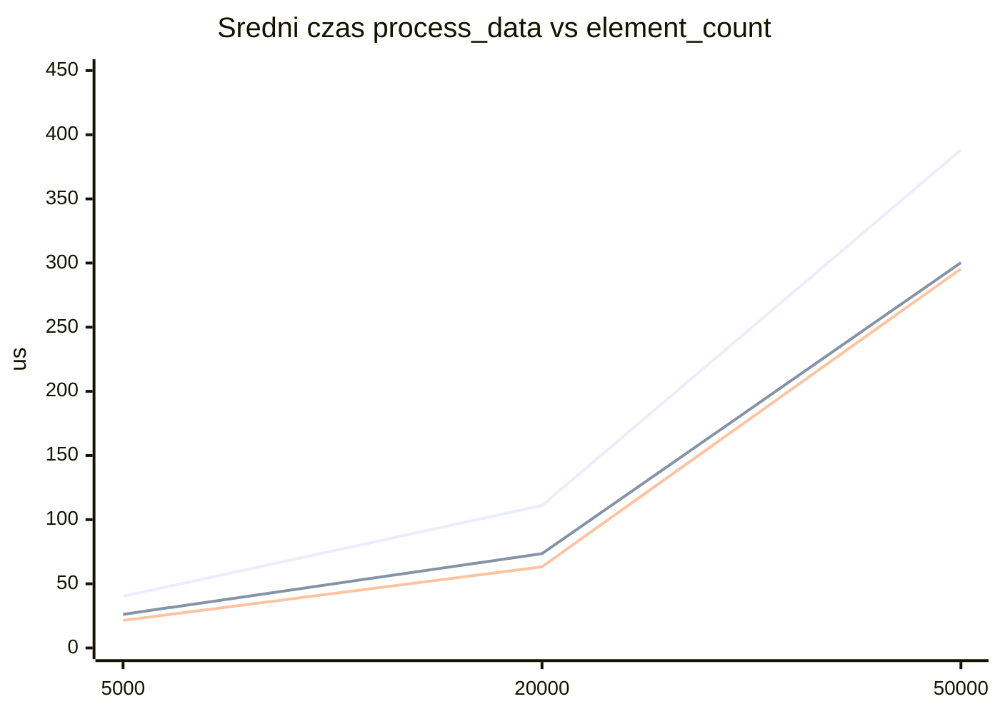

# Sprawozdanie TiDPI 03 - tablice lokalne, globalne i dynamiczne

## Kryptonim TiDPI i wykonany poziom

- Kryptonim: **Regulus**.
- Lekcja: TiDPI 03, tablice statyczne i dynamiczne.
- Data prób: 2026-10-01 (poziom A); 2026-10-02 (poziomy B, C i D).
- Zakres ukończony i sprawdzony: **poziomy A–D** (w tym rozszerzenie: raw `new[]` / `unique_ptr` / `vector`).
- Checklist zakresu:
    - [x] A
    - [x] B
    - [x] C (wybrane: koszt alokacji + granica lokalnej tablicy; bez x86/x64)
    - [x] D (porównanie raw / unique_ptr / vector, rozdzielona alokacja i przetwarzanie)
- Odstępstwa: polecenie zakłada Visual Studio 2022, MSVC i Windows. Prace wykonano na macOS/arm64 z Apple Clang i LLDB. Kroków w Visual Studio nie wykonano, ponieważ Visual Studio nie jest już oficjalnie wspierane. Eksperymentu „x86 i x64” nie wykonano — uzasadnienie w sekcji poziomu C.
- Wersja programu: [main.cpp](main.cpp); poziom C: [alloc_bench.cpp](alloc_bench.cpp) + [stack_probe/](stack_probe/); poziom D: [ownership_bench.cpp](ownership_bench.cpp) + [ownership_ops.cpp](ownership_ops.cpp).

## Cel i hipoteza

Cel poziomu A: sprawdzić, czy ten sam wzorzec danych i ta sama funkcja `process_data` dają poprawne wyniki w trzech wariantach przechowywania (lokalny `std::array`, globalny `FixedArray`, dynamiczny `std::unique_ptr<std::uint32_t[]>`), oraz zrozumieć różnice czasu przechowywania i RAII.

Hipoteza funkcjonalna poziomu A (zapisana przed uruchomieniami): jeśli przygotowanie, przetwarzanie i walidacja są wspólne, wszystkie trzy tablice w każdej próbie przejdą kontrolę początkową, końcową i porównanie element po elemencie. Celowa zmiana oczekiwań w `verify_processed_data` powinna dać `false` i kod wyjścia różny od zera. Nie wybieram zwycięzcy wydajności na poziomie A — czasy są tylko śladem wykonania, nie wnioskiem o „stercie vs stosie”.

Cel poziomu B: porównać czas samego `process_data` na już przydzielonych i przygotowanych danych dla trzech wartości `element_count`, w konfiguracji Release, przy stałym `rounds`.

Hipoteza wydajnościowa poziomu B (zapisana przed seriami Release): po wyłączeniu kosztu alokacji ze stopera trzy warianty będą miały zbliżone czasy; ewentualne różnice nie pozwolą wskazać stabilnej przewagi wynikającej z etykiety „stos / dane globalne / sterta”, a rozstęp między próbami może być porównywalny z różnicami między wariantami.

Cel poziomu C (wybrane dwa z trzech): (1) zmierzyć osobno koszt `std::make_unique<std::uint32_t[]>` wraz ze zwolnieniem, bez mieszania z `process_data`; (2) oszacować praktyczną granicę lokalnej tablicy o stałym rozmiarze na kopii projektu.

Hipoteza C1 — alokacja (przed pomiarem): koszt pary alokacja+zwolnienie jest mierzalny niezależnie od `process_data` i nie powinien być dodawany do czasów poziomu B jako „czas sterty”.

Hipoteza C2 — granica lokalnej tablicy (przed serią): powyżej pewnego `element_count` lokalny `std::array` w `main` zakończy się niepowodzeniem (np. przepełnienie stosu); otrzymana granica dotyczy tylko tej maszyny i konfiguracji, nie jest uniwersalna.

Cel poziomu D: porównać surową tablicę `new[]`/`delete[]`, `std::unique_ptr<std::uint32_t[]>` i `std::vector<std::uint32_t>` przy poprawnym rozdzieleniu kosztu alokacji+zwolnienia od kosztu `process_data` (osobny program [ownership_bench.cpp](ownership_bench.cpp)).

Hipoteza D (przed pomiarem): po `prepare_data` czasy `process_data` trzech wariantów będą zbliżone (ta sama pętla po `uint32_t*`). Koszty alokacji+zwolnienia mogą się różnić — zwłaszcza że `vector(n)` i typowo `make_unique` value-inicjalizują elementy, a surowy `new T[n]` bez `()` nie. Nie wolno mieszać obu faz ani wnioskować „RAII = wolniejsze przetwarzanie”.

## Środowisko oraz konfiguracja

Tabela 1 - narzędzia faktycznie użyte (D00).

| Element           | Wartość                                                           | Dowód    |
| ----------------- | ----------------------------------------------------------------- | -------- |
| System            | macOS 27.0, build 26A428                                          | D00      |
| Architektura      | arm64 (Apple Silicon); `sizeof(void*) = 8` (D03)                  | D00, D03 |
| Kompilator        | Apple Clang 21.0.0, C++17                                         | D00, D01 |
| Konfiguracja A    | Debug: `-O0 -g -D_DEBUG`                                          | D01      |
| Konfiguracja B    | Release: `-O2 -DNDEBUG`, bez debuggera                            | D04–D06  |
| Konfiguracja C1   | Release `-O2 -DNDEBUG`; ciało alokacji z `[[clang::optnone]]`     | D07      |
| Konfiguracja C2   | Debug `-O0` na kopii `stack_probe/`                               | D08      |
| Konfiguracja D    | Release `-O2 -DNDEBUG`; `ownership_bench` + `optnone` na alokacji | D09      |
| Debugger          | LLDB 2103.0.34.103 (zamiast VS Locals/Watch; tylko poziom A)      | D03      |
| Zegar w programie | `steady_clock`, wynik w µs                                        | kod      |

### D00 — wersje narzędzi (zapis z kontroli środowiska)

```text
host=macOS 27.0 build 26A428
arch=arm64
Apple clang version 21.0.0 (clang-2100.3.34.2)
Target: arm64-apple-darwin27.0.0
lldb-2103.0.34.103
actual_toolchain: Apple Clang + LLDB on macOS arm64
```

## Zmienne i warunki eksperymentu

- Stałe wspólne: `rounds = 100`, `trial_count = 6`, typ `std::uint32_t`, wzorzec początkowy `i % 1000`.
- Po przetwarzaniu oczekiwane: `i % 1000 + rounds`.
- Trzy warianty w każdej próbie; kolejność rotowana przez `trial % 3`.
- Alokacja i `prepare_data` poza stoperem; mierzona jest wyłącznie `process_data`.
- Poziom A: jeden `element_count = 50'000`, Debug `-O0` — nie jest serią wydajnościową.
- Poziom B: `element_count` ∈ {`5'000`, `20'000`, `50'000`}; każda zmiana wymaga rekompilacji; `rounds` bez zmian w środku serii; Release `-O2 -DNDEBUG`.
- Poziom C1: `element_count = 50'000`, `repetitions = 1000`, `series_count = 6`; stoper obejmuje wyłącznie `alloc_and_free_once` (`make_unique` + destruktor); bez `prepare_data` / `process_data`.
- Poziom C2: kopia w `stack_probe/`; rosnące `element_count` z zapisem bajtów = `n * 4`.

## Kontrola poprawności

Reguła: każdy element po `rounds` przejściach ma wartość początkową powiększoną o `rounds`. Program sprawdza każdy element (`verify_initial_data`, `verify_processed_data`) oraz porównuje trzy tablice przez `std::equal`. Checksum jest dodatkowym śladem, nie zastępuje pełnej walidacji.

Ręczne sprawdzenie sumy (D01): dla n = 50'000 jest 50 pełnych cykli 0…999, suma początkowa `50 * 499500 = 24'975'000`; po `+100` na element: `24'975'000 + 5'000'000 = 29'975'000`. Log pokazuje `29975000` we wszystkich trzech checksumach.

D01: we wszystkich sześciu próbach `fixed_ok`, `global_ok`, `dynamic_ok` i `equal` są `true`; `all_correct=true`, kod 0.

D02: po celowej zmianie oczekiwania na `i % 1000 + rounds + 1` wszystkie `*_ok` są `false`, `all_correct=false`, kod 1. `equal` pozostało `true`, bo trzy tablice nadal są sobie równe — różnią się od błędnego oczekiwania, nie od siebie. Po przywróceniu poprawnego wzoru przebudowany program znów kończy się `all_correct=true`.

D04–D06 (poziom B, Release): we wszystkich trzech seriach (łącznie 18 prób) `fixed_ok`, `global_ok`, `dynamic_ok` i `equal` są `true`; `all_correct=true`, kod wyjścia 0. Checksumy: n=5'000 → `2997500`; n=20'000 → `11990000`; n=50'000 → `29975000`.

D07 (C1): `smoke_ok=true` (zapis/odczyt pierwszego i ostatniego elementu poza stoperem), `all_ok=true`.

D08 (C2): kolejne warianty do `2'000'000` elementów kończą się `ok`; pierwszy nieudany w serii rosnącej: `2'250'000`, kod wyjścia 139 (SIGSEGV).

D09 (D): `smoke_ok=true`; faza alokacji z min/max/średnimi; faza `process_data`: 6/6 prób `raw_ok`/`unique_ok`/`vector_ok` = `true`; `all_ok=true`.

## Procedura

### Poziom A

1. Zbudowano Debug: `clang++ -std=c++17 -O0 -g -D_DEBUG -Wall -Wextra -pedantic -o .build/main_debug main.cpp`.
2. Uruchomiono program bazowy; pełny stdout wklejono poniżej jako D01.
3. Ręcznie policzono bajty i KiB; porównano z nagłówkiem programu.
4. W LLDB ustawiono breakpoint w `run_trial` (linia 109, po `prepare_data`); odczytano trzy adresy (D03, poniżej).
5. Tymczasowo zmieniono oczekiwanie w `verify_processed_data` na `+ rounds + 1`, przebudowano, wklejono D02, przywrócono kod i potwierdzono `all_correct=true`.

### Poziom B

1. Dla każdego `N` ∈ {`5'000`, `20'000`, `50'000`} ustawiono `element_count = N` w [main.cpp](main.cpp) i przebudowano Release: `clang++ -std=c++17 -O2 -DNDEBUG -Wall -Wextra -pedantic -o .build/main_release main.cpp`.
2. Uruchomiono bez debuggera; pełny stdout zapisano jako D04, D05, D06.
3. Sprawdzono `all_correct=true` i kod 0 w każdej serii.
4. Policzone minimum, maksimum i rozstęp czasów µs dla każdego wariantu w każdym rozmiarze; średnie arytmetyczne użyto na wykresie.
5. Po seriach przywrócono `element_count = 50'000`. Surowe wyniki pozostają wyłącznie w tym raporcie; tymczasowe pliki logów usunięto.

### Poziom C1 — koszt alokacji

1. Dodano [alloc_ops.cpp](alloc_ops.cpp) / [alloc_ops.hpp](alloc_ops.hpp) z `alloc_and_free_once` (`make_unique` + destruktor) oraz [alloc_bench.cpp](alloc_bench.cpp) jako osobny stoper.
2. Na ciele alokacji ustawiono `[[clang::optnone]]`, bo przy samym `-O2` Clang elidował `new`/`delete` (allocation elision) i pomiar dawał ~0 µs.
3. Zbudowano Release (osobne jednostki translacji) i uruchomiono 6 serii po 1000 powtórzeń (D07).
4. Stoper obejmuje wyłącznie wywołania `alloc_and_free_once`; poza nim: `smoke_check` oraz brak `process_data`.

### Poziom C2 — granica lokalnej tablicy

1. Utworzono kopię [stack_probe/main.cpp](stack_probe/main.cpp) (lokalny `std::array`, bez oryginalnego programu bazowego).
2. Stopniowo zwiększano `element_count` od `50'000`, za każdym razem zapisując bajty = `n * 4`, kompilując `-O0` i uruchamiając.
3. Zanotowano największy sukces oraz pierwszy wariant zakończony niepowodzeniem (D08). Granicy nie traktowano jako uniwersalnej.

### Poziom C — niewykonany wariant x86/x64

Nie uruchamiano serii „x86 i x64”. Uzasadnienie: patrz sekcja „Niewykonany eksperyment x86/x64” poniżej.

### Poziom D — raw / unique_ptr / vector

1. Dodano [ownership_ops.cpp](ownership_ops.cpp) (`alloc_free_raw` / `_unique` / `_vector` z `[[clang::optnone]]`) oraz [ownership_bench.cpp](ownership_bench.cpp).
2. Faza 1: 6 serii × 1000 powtórzeń samej alokacji+zwolnienia (bez `process_data`).
3. Faza 2: 6 prób — alokacja i `prepare_data` poza stoperem, pomiar tylko `process_data`; rotacja kolejności; surowa tablica zawsze z `delete[]` po verify.
4. Release: osobne `.o` + link; stdout jako D09; tymczasowy log usunięto po wklejeniu.

## Surowe wyniki

### Rejestr dowodów

Wszystkie dowody D00–D09 są w tym pliku. Osobne `.log` / `.stdout.txt` nie są częścią oddania. Źródła: [main.cpp](main.cpp), [alloc_bench.cpp](alloc_bench.cpp), [alloc_ops.cpp](alloc_ops.cpp), [stack_probe/main.cpp](stack_probe/main.cpp), [ownership_bench.cpp](ownership_bench.cpp), [ownership_ops.cpp](ownership_ops.cpp).

- **D00:** wersje narzędzi (sekcja Środowisko).
- **D01:** pełny stdout poprawnego przebiegu Debug.
- **D02:** pełny stdout po celowym zepsuciu `verify_processed_data`, potem przywrócenie kodu.
- **D03:** skrypt LLDB i fragment transkryptu z trzema adresami.
- **D04:** Release, `element_count=5000`, 6 prób.
- **D05:** Release, `element_count=20000`, 6 prób.
- **D06:** Release, `element_count=50000`, 6 prób.
- **D07:** Release, osobny pomiar alokacji+zwolnienia (6 × 1000).
- **D08:** tabela rosnących `element_count` na kopii `stack_probe/`.
- **D09:** Release, `ownership_bench` — alokacja i przetwarzanie raw/unique/vector.

### D01 — pełny stdout (Debug, poprawny kod)

```text
element_count=50000
bytes_per_array=200000
kibibytes_per_array=195.312
trial;fixed_us;global_us;dynamic_us;fixed_ok;global_ok;dynamic_ok;equal;fixed_checksum;global_checksum;dynamic_checksum
1;2736;2818;2705;true;true;true;true;29975000;29975000;29975000
2;2638;2760;2867;true;true;true;true;29975000;29975000;29975000
3;2635;2540;2623;true;true;true;true;29975000;29975000;29975000
4;2799;2767;2561;true;true;true;true;29975000;29975000;29975000
5;2643;2782;2870;true;true;true;true;29975000;29975000;29975000
6;2584;2614;3164;true;true;true;true;29975000;29975000;29975000
all_correct=true
exit=0
```

### Ręczne bajty i kibibajty

- Bajty: `50'000 * sizeof(std::uint32_t) = 50'000 * 4 = 200'000`.
- KiB: `200'000 / 1024 = 195,3125` (kibibajt = 1024 B).
- Program (D01): `bytes_per_array=200000`, `kibibytes_per_array=195.312` — zgodne w granicach zapisu zmiennoprzecinkowego.

### D02 — pełny stdout (celowo błędne oczekiwanie)

Zmiana: w `verify_processed_data` oczekiwanie `i % 1000 + rounds + 1` zamiast `+ rounds`. Po zapisie wyniku kod przywrócono.

```text
element_count=50000
bytes_per_array=200000
kibibytes_per_array=195.312
trial;fixed_us;global_us;dynamic_us;fixed_ok;global_ok;dynamic_ok;equal;fixed_checksum;global_checksum;dynamic_checksum
1;2707;2806;2754;false;false;false;true;29975000;29975000;29975000
2;2487;2733;2616;false;false;false;true;29975000;29975000;29975000
3;2747;2642;2743;false;false;false;true;29975000;29975000;29975000
4;2628;2648;2730;false;false;false;true;29975000;29975000;29975000
5;2594;2653;2759;false;false;false;true;29975000;29975000;29975000
6;2824;2695;2751;false;false;false;true;29975000;29975000;29975000
all_correct=false
exit=1
```

### D03 — LLDB: skrypt i adresy (próba 1)

Polecenia (batch):

```text
breakpoint set --file main.cpp --line 109
run
expression -- (void*)fixed_values.data()
expression -- (void*)global_values.data()
expression -- (void*)dynamic_values.get()
expression -- sizeof(void*)
continue
quit
```

Fragment transkryptu (ścieżki zanonimizowane do `<katalog-zadania>`):

```text
Breakpoint 1: where = main_debug`run_trial(int) + 204 at main.cpp:109:41
Process 4452 stopped
* thread #1, stop reason = breakpoint 1.1
    frame #0: main_debug`run_trial(trial=1) at main.cpp:109:41
(lldb) expression -- (void*)fixed_values.data()
(void *) $0 = 0x000000016fdcc46c
(lldb) expression -- (void*)global_values.data()
(void *) $1 = 0x0000000100008000
(lldb) expression -- (void*)dynamic_values.get()
(void *) $2 = 0x0000007bc7400000
(lldb) expression -- sizeof(void*)
(unsigned long) $3 = 8
```

| Wskaźnik               | Adres z tej sesji LLDB |
| ---------------------- | ---------------------- |
| `fixed_values.data()`  | `0x000000016fdcc46c`   |
| `global_values.data()` | `0x0000000100008000`   |
| `dynamic_values.get()` | `0x0000007bc7400000`   |

Trzy adresy są różne. Nie zakładam, że powtórzą się przy następnym uruchomieniu ani że standard C++ narzuca konkretny układ stos/sterta. Obserwacja dotyczy wyłącznie tej sesji Debug.

### D04 — Release, element_count=5000

```text
element_count=5000
bytes_per_array=20000
kibibytes_per_array=19.5312
trial;fixed_us;global_us;dynamic_us;fixed_ok;global_ok;dynamic_ok;equal;fixed_checksum;global_checksum;dynamic_checksum
1;77;42;43;true;true;true;true;2997500;2997500;2997500
2;29;42;20;true;true;true;true;2997500;2997500;2997500
3;32;20;17;true;true;true;true;2997500;2997500;2997500
4;36;20;16;true;true;true;true;2997500;2997500;2997500
5;33;16;16;true;true;true;true;2997500;2997500;2997500
6;34;17;17;true;true;true;true;2997500;2997500;2997500
all_correct=true
```

### D05 — Release, element_count=20000

```text
element_count=20000
bytes_per_array=80000
kibibytes_per_array=78.125
trial;fixed_us;global_us;dynamic_us;fixed_ok;global_ok;dynamic_ok;equal;fixed_checksum;global_checksum;dynamic_checksum
1;107;71;60;true;true;true;true;11990000;11990000;11990000
2;107;60;61;true;true;true;true;11990000;11990000;11990000
3;107;69;60;true;true;true;true;11990000;11990000;11990000
4;106;81;74;true;true;true;true;11990000;11990000;11990000
5;121;80;64;true;true;true;true;11990000;11990000;11990000
6;118;80;61;true;true;true;true;11990000;11990000;11990000
all_correct=true
```

### D06 — Release, element_count=50000

```text
element_count=50000
bytes_per_array=200000
kibibytes_per_array=195.312
trial;fixed_us;global_us;dynamic_us;fixed_ok;global_ok;dynamic_ok;equal;fixed_checksum;global_checksum;dynamic_checksum
1;458;316;293;true;true;true;true;29975000;29975000;29975000
2;390;294;294;true;true;true;true;29975000;29975000;29975000
3;377;293;293;true;true;true;true;29975000;29975000;29975000
4;340;268;293;true;true;true;true;29975000;29975000;29975000
5;382;343;312;true;true;true;true;29975000;29975000;29975000
6;382;288;288;true;true;true;true;29975000;29975000;29975000
all_correct=true
```

### D07 — Release, koszt alokacji + zwolnienia (osobny program)

Stoper: czas 1000 wywołań `alloc_and_free_once` na serię. Każde wywołanie to `std::make_unique<std::uint32_t[]>(50000)` oraz destruktor `unique_ptr` (`delete[]`) przy wyjściu z funkcji. Poza stoperem: `smoke_check` (pierwszy i ostatni element). Bez `prepare_data` i bez `process_data`. Minimalny zapis `p[0]` + `alloc_sink` oraz `[[clang::optnone]]` na ciele alokacji zapobiegają elizji alokacji przy `-O2`.

```text
experiment=alloc_free
element_count=50000
bytes_per_array=200000
repetitions_per_series=1000
series_count=6
timer_covers=alloc_and_free_once=make_unique_uint32_array_plus_unique_ptr_destructor
timer_excludes=prepare_data_and_process_data
note=clang_optnone_on_alloc_body_blocks_allocation_elision
smoke_ok=true
series;total_us;mean_us_per_alloc_free
1;1667;1.667
2;1449;1.449
3;1488;1.488
4;1365;1.365
5;1329;1.329
6;1299;1.299
min_total_us=1299
max_total_us=1667
range_total_us=368
mean_total_us=1432.83
mean_us_per_alloc_free=1.43283
alloc_sink=999
all_ok=true
```

### D08 — granica lokalnej tablicy (kopia stack_probe)

Kompilacja: `clang++ -std=c++17 -O0 ... stack_probe/main.cpp`. Niepowodzenie: kod wyjścia 139 (128+11, SIGSEGV).

```text
element_count;bytes;result;detail
50000;200000;ok;exit=0
100000;400000;ok;exit=0
250000;1000000;ok;exit=0
500000;2000000;ok;exit=0
750000;3000000;ok;exit=0
1000000;4000000;ok;exit=0
1250000;5000000;ok;exit=0
1500000;6000000;ok;exit=0
1750000;7000000;ok;exit=0
2000000;8000000;ok;exit=0
2250000;9000000;fail;exit=139
2100000;8400000;fail;exit=139
2200000;8800000;fail;exit=139
```

Największy uruchomiony wariant: `element_count = 2'000'000` (8'000'000 B). Pierwszy nieudany w serii rosnącej: `2'250'000` (9'000'000 B). Punkty pośrednie `2'100'000` i `2'200'000` też kończą się SIGSEGV — praktyczny sufit leży między 8 MiB a 8,4 MiB lokalnej tablicy w tej konfiguracji. To nie jest granica uniwersalna.

### D09 — Release, raw / unique_ptr / vector (ownership_bench)

Faza 1: stoper obejmuje wyłącznie `alloc_free_*` (alokacja + zwolnienie). Faza 2: alokacja i `prepare_data` poza stoperem; mierzone tylko `process_data`. Surowa tablica: ręczny `delete[]` po verify.

```text
experiment=ownership_raw_unique_vector
element_count=50000
bytes_per_array=200000
rounds=100
alloc_repetitions_per_series=1000
alloc_series_count=6
process_trial_count=6
phase1_timer=alloc_and_free_only
phase2_timer=process_data_only_after_prepare
note=vector_n_value_initializes_uint32_t_to_zero
note=optnone_on_alloc_bodies_blocks_allocation_elision
smoke_ok=true
phase=alloc_free
series;raw_total_us;unique_total_us;vector_total_us;raw_mean_us;unique_mean_us;vector_mean_us
1;138;1557;1521;0.138;1.557;1.521
2;112;1385;1437;0.112;1.385;1.437
3;109;1373;1403;0.109;1.373;1.403
4;101;1271;1319;0.101;1.271;1.319
5;111;1285;1324;0.111;1.285;1.324
6;97;1262;1254;0.097;1.262;1.254
raw_min_total_us=97
raw_max_total_us=138
raw_range_total_us=41
raw_mean_total_us=111.333
raw_mean_us_per_alloc_free=0.111333
unique_min_total_us=1262
unique_max_total_us=1557
unique_range_total_us=295
unique_mean_total_us=1355.5
unique_mean_us_per_alloc_free=1.3555
vector_min_total_us=1254
vector_max_total_us=1521
vector_range_total_us=267
vector_mean_total_us=1376.33
vector_mean_us_per_alloc_free=1.37633
phase=process
trial;raw_us;unique_us;vector_us;raw_ok;unique_ok;vector_ok
1;365;355;356;true;true;true
2;361;351;354;true;true;true
3;336;344;361;true;true;true
4;337;352;331;true;true;true
5;324;356;364;true;true;true
6;320;330;328;true;true;true
ownership_sink=999
all_ok=true
```

## Opracowanie wyników

Tabela 2 - skrót kontroli funkcjonalnej poziomu A.

| Dowód | Wynik funkcjonalny                           | Kod |
| ----- | -------------------------------------------- | --- |
| D01   | 6/6 prób: wszystkie flagi `true`             | 0   |
| D02   | 6/6 prób: `*_ok=false`, `equal=true`         | 1   |
| D03   | trzy różne adresy w jednej ramce `run_trial` | —   |

Czasy µs w D01 nie służą do wyłonienia zwycięzcy: konfiguracja to Debug `-O0`, a poziom A nie jest eksperymentem wydajnościowym Release.

Tabela 3 - poziom B: minimum, maksimum i rozstęp czasu `process_data` [µs] (D04–D06).

| n      | Wariant | min | max | rozstęp | średnia |
| ------ | ------- | --- | --- | ------- | ------- |
| 5'000  | fixed   | 29  | 77  | 48      | 40,2    |
| 5'000  | global  | 16  | 42  | 26      | 26,2    |
| 5'000  | dynamic | 16  | 43  | 27      | 21,5    |
| 20'000 | fixed   | 106 | 121 | 15      | 111,0   |
| 20'000 | global  | 60  | 81  | 21      | 73,5    |
| 20'000 | dynamic | 60  | 74  | 14      | 63,3    |
| 50'000 | fixed   | 340 | 458 | 118     | 388,2   |
| 50'000 | global  | 268 | 343 | 75      | 300,3   |
| 50'000 | dynamic | 288 | 312 | 24      | 295,5   |

Wykres 1 - średni czas przetwarzania [µs] względem `element_count` (Release, `rounds=100`).



We wszystkich trzech seriach Release czas rośnie wraz z liczbą elementów. Średnie `fixed` leżą najwyżej; `global` i `dynamic` są bliżej siebie, zwłaszcza przy n = 50'000.

Tabela 4 - poziom C1: czas 1000 × (alokacja+zwolnienie) [µs] (D07).

| Statystyka (total_us / seria) | Wartość |
| ----------------------------- | ------- |
| min                           | 1299    |
| max                           | 1667    |
| rozstęp                       | 368     |
| średnia total                 | 1432,83 |
| średnia na 1× alloc+free      | ≈ 1,43  |

Porównanie rzędu wielkości z poziomem B (n = 50'000, średnie `process_data` ≈ 295–388 µs): pojedyncza alokacja+zwolnienie (~1,4 µs) jest o rzędy mniejsze niż jedno pełne `process_data` z `rounds = 100`, ale to osobne pytania badawcze — nie wolno ich sumować jako jednego „czasu sterty”.

## Interpretacja

### Poziom A

Obserwacja: trzy warianty pamięci przeszły pełną walidację na tych samych danych i tej samej operacji. Celowa zmiana reguły oczekiwanej została wykryta mimo że tablice nadal były sobie równe — pełna kontrola względem wzorca jest konieczna, a sama zgodność między wariantami nie wystarcza.

Obserwacja adresów: lokalny `std::array` leżał pod innym adresem niż obiekt globalny i niż tablica ze sterty. To nie dowodzi uniwersalnego „kierunku” wzrostu stosu ani sterty.

Wyjaśnienie rodzajów pamięci:

1. **Lokalna tablica o stałym rozmiarze** (`FixedArray fixed_values` w `run_trial`): automatyczny czas życia; obiekt (i jego elementy wewnątrz `std::array`) żyje do końca bloku/funkcji. Rozmiar ustalony w czasie kompilacji.
2. **Globalna tablica** (`global_values`): ten sam typ, ale statyczny czas przechowywania — istnieje przez całe działanie programu. Przed każdą próbą program ponownie wywołuje `prepare_data`, żeby nie dziedziczyć przetworzonych wartości.
3. **Lokalny obiekt ze `static`**: miałby statyczny czas życia mimo zakresu lokalnego (inicjalizacja raz, trwałość między wywołaniami). W tym programie **nie występuje**; kontrastuje z globalnym obiektem (widoczność/powiązanie z jednostką translacji) i z lokalnym automatycznym `fixed_values`.
4. **Tablica dynamiczna** (`std::make_unique<std::uint32_t[]>`): rozmiar w czasie działania, pamięć na stercie; `.get()` daje surowy wskaźnik funkcjom bez przeniesienia własności.

**RAII i `std::unique_ptr`:** własność tablicy jest związana z obiektem `dynamic_values`. Gdy `run_trial` kończy się normalnie lub wczesnym `return` po nieudanej kontroli początkowej, destruktor `unique_ptr` zwalnia pamięć (`delete[]`). Nie trzeba ręcznego `delete[]` w każdej ścieżce wyjścia — to realizacja zasady Resource Acquisition Is Initialization (RAII) dla tej tablicy.

### Poziom B

**Obserwacja (bez przyczyny):**

1. We wszystkich seriach D04–D06 testy funkcjonalne przeszły (`all_correct=true`).
2. Średni czas każdego wariantu rośnie wraz z `element_count` (Tabela 3, Wykres 1).
3. Wariant `fixed` ma najwyższą średnią w każdym z trzech rozmiarów.
4. Warianty `global` i `dynamic` mają zbliżone średnie; przy n = 50'000 różnica średnich wynosi ok. 5 µs (300,3 vs 295,5), a zakresy [268, 343] i [288, 312] mocno się nakładają.
5. Przy n = 5'000 rozstępy (48 / 26 / 27 µs) są duże względem różnic między średnimi — pojedyncze próby są szumne.
6. Nie ma wariantu, który wygrywałby _każdą_ próbę we wszystkich rozmiarach. Stabilnie wolniejszy w średniej jest tylko `fixed`; między `global` a `dynamic` nie da się wskazać jednoznacznej, trwałej przewagi na podstawie tych trzech serii.

**Przypuszczenie o przyczynie (oddzielone od obserwacji):**

Różnica `fixed` vs pozostałe może wynikać z szczegółów wygenerowanego kodu Release, położenia danych względem pamięci podręcznej albo z narzutu lokalnej tablicy o stałym rozmiarze w ramce funkcji — to nie jest jednak dowód, że „stos jest wolniejszy od sterty”. Bliskość `global` i `dynamic` jest zgodna z hipotezą, że po przygotowaniu pamięci procesor wykonuje tę samą pętlę na ciągłych `uint32_t` niezależnie od etykiety obszaru. Szum przy małych n może pochodzić z rozdzielczości zegara, rozgrzewania i zadań systemowych w tle.

### Poziom C1 — alokacja

**Obserwacja:** `smoke_ok=true`; średni koszt jednej pary alokacja+zwolnienie ≈ 1,43 µs (D07); rozstęp sum 1000 powtórzeń to 368 µs. Stoper nie obejmuje `process_data`.

**Przypuszczenie:** bez `[[clang::optnone]]` kompilator Release usuwał alokację (elizja), więc pomiar bez tej ostrożności nie dotyczyłby alokatora. Koszt przydziału jest osobnym pytaniem względem kosztu przejścia po już zajętej pamięci.

### Poziom C2 — granica lokalnej tablicy

**Obserwacja:** największy sukces `2'000'000` elementów / 8'000'000 B; pierwszy fail w serii rosnącej `2'250'000` / 9'000'000 B z exit 139; także `2'100'000` kończy się SIGSEGV (D08).

**Przypuszczenie:** lokalna tablica w tej konfiguracji trafia na limit stosu procesu (typowo rzędu 8 MiB na macOS), ale to tylko hipoteza zgodna z rzędem bajtów — nie uniwersalna stała C++ ani gwarancja dla innych systemów, linkera czy ustawień wątku.

### Niewykonany eksperyment x86/x64

Polecenie wymaga tej samej serii Release na dwóch platformach oraz sprawdzenia `sizeof(void*)`, przy oddzieleniu różnicy rozmiaru wskaźnika od wniosku o czasie.

Na macOS arm64:

- natywny arm64 ma `sizeof(void*) == 8` (D03);
- ewentualny przebieg x86_64 (Rosetta) też ma wskaźnik 8 B — nie realizuje pytania o różnicę 4 vs 8;
- natywny 32-bitowy x86 jest na tym systemie niedostępny.

Najbliższe obejście — Docker z emulacją `linux/386` (wskaźnik 4 B) kontra arm64/amd64 — **nie wchodzi w grę**: warunki nie są identyczne (ciężka emulacja QEMU), czasy nie są porównywalne z natywnym przebiegiem, a sam fakt uzyskania `sizeof(void*) == 4` pod emulatorem nie spełnia rzetelnego porównania platform z polecenia. Dlatego trzeciego eksperymentu nie wykonano; wybrano koszt alokacji i granicę lokalnej tablicy.

### Poziom D — raw / unique_ptr / vector

Tabela 5 - faza alokacji+zwolnienia, średnia na 1 wywołanie [µs] (D09).

| Wariant                | min total (1000×) | max total | rozstęp | średnia / 1× |
| ---------------------- | ----------------- | --------- | ------- | ------------ |
| raw `new[]`/`delete[]` | 97                | 138       | 41      | ≈ 0,11       |
| `unique_ptr`           | 1262              | 1557      | 295     | ≈ 1,36       |
| `vector`               | 1254              | 1521      | 267     | ≈ 1,38       |

Tabela 6 - faza `process_data` [µs] (D09).

| Wariant      | min | max | rozstęp | średnia |
| ------------ | --- | --- | ------- | ------- |
| raw          | 320 | 365 | 45      | 340,5   |
| `unique_ptr` | 330 | 356 | 26      | 348,0   |
| `vector`     | 328 | 364 | 36      | 349,0   |

**Obserwacja:** `all_ok=true` we wszystkich 6 próbach przetwarzania. Średnie `process_data` leżą w wąskim paśmie (~340–349 µs); zakresy się nakładają. W fazie alokacji raw jest o rząd wielkości szybszy niż `unique_ptr` i `vector`, które są do siebie zbliżone.

**Przypuszczenie:** bliskość czasów przetwarzania wynika z tej samej pętli po `uint32_t*` (`data()` / `.get()` / surowy wskaźnik). Różnica w alokacji prawdopodobnie wynika m.in. z tego, że surowy `new uint32_t[n]` **nie** value-inicjalizuje elementów, a `vector(n)` oraz `make_unique<uint32_t[]>` typowo **tak** (zera) — to nie jest dowód, że „RAII jest wolne”, tylko że porównywane konstrukcje robią różną pracę przy tworzeniu. Ręczny `delete[]` w wariancie raw jest obowiązkowy; `unique_ptr` i `vector` zwalniają przez RAII.

## Ograniczenia eksperymentu

1. Jedna maszyna (macOS arm64); serie A–D na tym samym hoście.
2. Poziomy B/C1/D rozdzielają alokację od `process_data` osobnymi stopami.
3. Adresy z D03 są jednorazową obserwacją Debug.
4. Brak Visual Studio; Release to Apple Clang `-O2 -DNDEBUG`, nie MSVC `/O2`.
5. Trzy punkty na osi `element_count` w B nie opisują pełnej krzywej; rozstęp przy małych n i przy `fixed` (50k) jest duży.
6. C1/D: `optnone` na ciele alokacji blokuje elizję — wynik nie jest „najszybszym możliwym new w samym -O2”.
7. C2: granica stosu jest lokalna; kroki `element_count` są skokowe.
8. Eksperymentu x86/x64 nie wykonano (sekcja powyżej).
9. D: surowy `new T[n]` bez value-init vs `vector`/`make_unique` — alokacje nie są w pełni równoważne semantycznie; to ograniczenie porównania fazy 1.

## Wnioski

1. Program bazowy na poziomie A jest funkcjonalnie poprawny: D01 ma `all_correct=true` i zgodne checksumy 29'975'000.
2. Ręczne 200'000 B / 195,3125 KiB zgadzają się z komunikatem programu.
3. Kontrola weryfikacji działa: celowa zmiana oczekiwania (D02) daje `all_correct=false` i kod 1; po przywróceniu kod jest znowu poprawny.
4. Trzy warianty mają różne adresy w tej sesji (D03); `unique_ptr` pilnuje zwolnienia przez RAII.
5. Poziom B: trzy serie Release (D04–D06) przeszły testy funkcjonalne; czas rośnie z `element_count`.
6. Poziom B: wyniki nie pozwalają wskazać stabilnej przewagi `global` nad `dynamic` (ani odwrotnie). `fixed` ma wyższe średnie we wszystkich trzech rozmiarach, ale przy dużym rozstępie i bez dowodu przyczyny „stos vs sterta” nie należy tego uogólniać.
7. Poziom C1: osobny pomiar alokacji+zwolnienia (D07) jest mierzalny i oddzielny od `process_data`; nie należy go doliczać do czasów B jako „kosztu sterty”.
8. Poziom C2: na tej maszynie lokalny `std::array` działa do 2'000'000 elementów (8 MiB) i zawodzi od co najmniej 2'100'000 (D08); granica nie jest uniwersalna.
9. Eksperymentu x86/x64 nie da się tu rzetelnie zrealizować; Docker jako obejście też odpada.
10. Poziom D: po rozdzieleniu faz `process_data` dla raw / `unique_ptr` / `vector` ma zbliżone czasy (D09); różnice widać głównie w alokacji — nie wolno z tego wnioskować, że RAII spowalnia przetwarzanie. Surowy wariant wymaga ręcznego `delete[]`.

## Wykorzystanie AI i sposób weryfikacji

Asystent pomógł naprawić uszkodzony nagłówek CSV w `main.cpp`, uruchomić serie Debug/Release, przygotować skrypt LLDB, bench alokacji (w tym wykrycie elizji `-O2`), poprawić kod przy testowaniu przykładów w zadaniu D, policzyć min/max/rozstęp/średnie oraz uporządkować treść raportu do odpowiednich kategorii. Nie wymyślano wyników: liczby pochodzą z D01–D09.

Sprawdzono ręcznie: `50'000 * 4 = 200'000`, `200'000 / 1024 = 195,3125`, sumę checksum 29'975'000, obecność `true`/`false` w D01/D02 oraz trzy adresy w D03. Po D02 potwierdzono przywrócenie `+ rounds` w [main.cpp](main.cpp). Dla B sprawdzono `all_correct=true` w D04–D06 oraz min/max/rozstęp. Dla C1: `smoke_ok`/`all_ok` i średnia ≈ 1,43 µs. Dla C2: `2'000'000 * 4 = 8'000'000` oraz exit 139 = SIGSEGV. Dla D: `all_ok=true`, średnie process ≈ 340–349 µs oraz osobne średnie alokacji z D09.
